# Hyperliquid Bootcamp: the curriculum

As of 3 Nov 2026. Official docs links come from the Hyperliquid GitBook sitemap and the pages that carry numbers were opened that day. This file is generated from the site by `tools/gen-docs.js`: every lesson, figure, quiz and media card below is the same one the page shows. The interactive version, with sandboxes you can play with, a live market clock, calculators and a journal, is at [abilashsenth.github.io/Hyperliquid-Bootcamp/](https://abilashsenth.github.io/Hyperliquid-Bootcamp/).

## How to use this

This is a stack, not a reading list: ten layers, each a skill the next one assumes, the way HTML comes before CSS, CSS before JavaScript, and React before Next.js. Layer 0 is the order book. Layer 7 is you running a written trade plan with a journal. Nothing in between is optional, and nothing after Layer 7 is required to be a competent manual trader.

Each layer has the same shape. **Goal** (what you can do afterwards) and **the surprise** (the one thing in the layer that changes how you trade). **The lesson**: short numbered sections that build the idea from zero, each with a figure, a one-line takeaway, and often a quick check; sections marked *Try it* have a sandbox on the site. **Recap**: the same ideas in one line each. **Read** (official docs first, then the vetted media for the layer), **Do** (hands-on drills, on testnet until Layer 7) and **Passed when** (a concrete check). Do the drill before moving on; reading alone does not transfer.

Pace: 8 weeks at 5 to 8 hours a week. Prerequisites: a wallet you control (MetaMask or Rabby), a browser, and comfort reading a basic price chart. The testnet faucet only pays an address that has deposited on mainnet, so day one needs a one-time deposit of about 10 USDC. Nothing else is at risk before Layer 7, and even then the plan starts at the smallest size the exchange allows.

Before the first drill, do the one-time setup (Layer 2 has the detail and the links):

1. Wallet: Rabby or MetaMask, a fresh wallet used only for this, seed phrase offline. Email login works but gives different addresses on mainnet and testnet, so use a wallet.
2. Mainnet: deposit about 10 USDC on Arbitrum (keep a little ETH there for gas). The first deposit pays a 1 USDC activation fee. This unlocks the testnet faucet.
3. Testnet: app.hyperliquid-testnet.xyz/drip pays 1,000 mock USDC to an address that has deposited on mainnet.
4. Click Enable Trading and sign the gas-free message. Withdrawals back to Arbitrum cost $1 and take a few minutes.

Ground rules:

- Testnet first. Every drill runs on [app.hyperliquid-testnet.xyz](https://app.hyperliquid-testnet.xyz) with faucet USDC until the schedule says otherwise.
- Official docs win. Third-party explainers are linked for intuition; when they disagree with [hyperliquid.gitbook.io/hyperliquid-docs](https://hyperliquid.gitbook.io/hyperliquid-docs), the docs are right.
- Exchange clocks are UTC. The calendar in Layer 5 is written for IST (UTC+5:30); shift it for your own zone.
- Journal from the first testnet order. Layer 7 is built on that journal.

In the figures, green is the bid side (buyers, longs), red the ask side (sellers, shorts, liquidation), blue is you (your order, your position, your level), amber is an outside reference (the oracle, spot, an underlying).

Contents: [Layer 0](#layer-0--the-order-book) · [Layer 1](#layer-1--perpetuals) · [Layer 2](#layer-2--the-hyperliquid-machine) · [Layer 3](#layer-3--prices-and-funding) · [Layer 4](#layer-4--margin-liquidation-and-sizing) · [Layer 5](#layer-5--time-sessions-and-timezones) · [Layer 6](#layer-6--reading-the-market) · [Layer 7](#layer-7--plan-journal-review-psychology) · [Layer 8](#layer-8--the-rest-of-hyperliquid) · [Layer 9](#layer-9--tooling-optional) · [Eight-week schedule](#eight-week-schedule) · [Glossary](#glossary) · [Quiz answers](#quiz-answers)

## Layer 0 · The order book (the HTML of the stack)

**Goal.** Read a live book and know, before you click, the price you will get and what it will cost.

> Most of what traders later call manipulation is just depth. A market order does not have a price. It has a path through the book.

### The lesson

This is the ground floor. Perps, funding, liquidation, everything later sits on top of the order book, so it is worth going slowly here. Nothing in the reading needs money or a wallet: the pictures and the sandboxes do the work. The drills at the end do need a testnet account, which takes a fresh wallet, a one-time 10 USDC deposit on mainnet and the faucet; the steps are in [Layer 2’s setup box](https://abilashsenth.github.io/Hyperliquid-Bootcamp/#layer-2/setup), so do them before you reach the drills. Read a section, play with its sandbox, answer the check, move on.

_In every picture, green is the bid side (buyers), red is the ask side (sellers), and blue is you: your order or your position._

#### 1. A market is a list of people who have not agreed yet

Picture a street market with one stall trading bitcoin. Buyers call out the most they will pay. Sellers call out the least they will take. Until a buyer’s number meets a seller’s number nothing happens; the numbers just hang in the air. An order book is that list of hanging numbers, written down and sorted by price.

Each line in the book is a **resting order**: someone’s promise to buy or sell a stated size at a stated price, waiting. Buy orders are **bids**. Sell orders are **asks** (some people say offers). The book keeps bids sorted from highest to lowest and asks from lowest to highest, so the two sides face each other across a gap.

Notice what the book is not. It is not a record of trades. Nothing on it has happened yet. It is a list of intentions, and intentions get withdrawn far more often than they get filled.

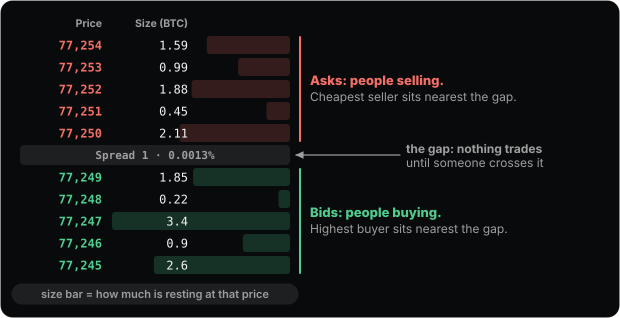

_A BTC book. Sellers rest above the gap, buyers below. The two numbers nearest the gap are the only ones that can trade next._

**Takeaway.** The book is every resting promise to buy or sell, sorted by price. Nothing on it has happened yet.

#### 2. Best bid, best ask, spread, mid

The highest bid and the lowest ask are the **best bid** and **best ask**: the two prices closest to agreeing. The gap between them is the **spread**. Halfway across the gap is the **mid**, the single number people mean when they say “the price”.

The spread is your first cost, and it is charged before any fee. If you buy right now you pay the ask; if you then sell right now you receive the bid. Do both and you are poorer by exactly the spread, even though the market did not move.

On BTC the spread is usually one tick: one dollar on a 77,000-dollar coin, about 0.0013%. On a small coin it can be 0.1% or more, nearly a hundred times wider, and that difference decides what kind of trading is even possible there. A strategy that scalps a few ticks on BTC is impossible on a coin where the spread alone is a few ticks’ worth of profit.

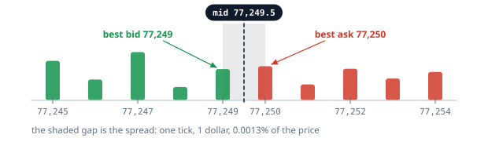

_One tick wide: the best bid at 77,249, the best ask at 77,250, the mid at 77,249.5. Buying at the ask and selling at the bid loses the shaded gap._

**Takeaway.** The spread is paid before any fee. A one-tick spread on BTC and a 0.1% spread on a small coin are different games.

<details><summary><b>Quick check.</b> You buy at market and sell at market one second later. The price did not move. What did you lose?</summary>

- a) The spread, plus a fee on each of the two fills
- b) Nothing, because the price did not move
- c) Only one fee, because it was one round trip

**Answer: a.** You paid the ask on the way in and received the bid on the way out, so you lost the gap between them. Each fill also pays a fee; Section 7 explains the two fee rates.

</details>

#### 3. Watch a book breathe

Below is a pretend BTC book that behaves like the real one: orders arrive, orders leave, and every few seconds a trade takes a bite out of the top. Watch the best bid and best ask for a while. Then watch the sizes two or three rows back.

Three things to notice. The top of the book changes constantly, often several times a second on the real thing. Most of that change is orders being added and cancelled, not trades: on a busy book most orders are cancelled unfilled. And the size at a level is not a wall; it is a crowd that can leave the moment you lean on it.

> **Try it on the site: A book that breathes.** Press pause when something interesting happens. The spread row in the middle shows the gap in dollars and as a percentage, the way the Hyperliquid app shows it. [Open the sandbox](https://abilashsenth.github.io/Hyperliquid-Bootcamp/#layer-0/live).

**Takeaway.** The book is a crowd of opinions that can change its mind. Treat the size you see as a hint, not a guarantee.

#### 4. Depth: how much is waiting at each price

The size column tells you how much is resting at each price. Add the sizes up as you move away from the mid and you get **depth**: how much could trade before the price has to move to the next level, and the next.

Trading apps draw depth two ways. The ladder draws a bar behind each row, proportional to the size there. The depth chart adds the bars up into two slopes that meet at the mid, like a valley. A deep book has steep walls close to the mid; a thin book has a wide, flat floor where a small order can travel a long way.

Depth is why the same order is harmless on BTC and dangerous on a small coin. Ten BTC is a lot of money, but a BTC book will often swallow it within a few dollars of the mid. Ten thousand dollars of a thin coin can move its price by a percent.

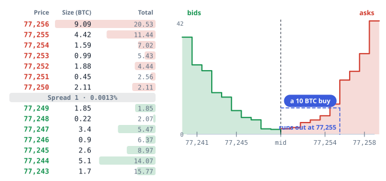

_The same book, twice. On the ladder each level has a bar and a running total. On the depth chart the totals become slopes; the dashed line is a 10 BTC buy, which runs out of asks at 77,255._

**Takeaway.** Depth is the book’s capacity to absorb an order without moving. It is the number behind the word liquidity.

#### 5. A market order walks the book

A **market order** says “fill me now, whatever it costs”. It starts at the best price and takes everything resting there. If that is not enough it moves to the next price and takes that too, and keeps going until it is done. Your fill is the size-weighted average of every level it touched.

The difference between the price you saw and the average price you got is **slippage**. It is not a fee and nobody charges it; it is just the shape of the book, which is why the same order slips more at 3 a.m. on a Sunday than at the US open.

Drag the size slider below and watch the order eat its way up the asks. Then switch to the thin book and do it again.

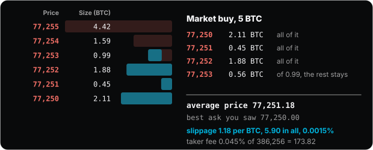

> **Try it on the site: Walk the book.** The BTC book here is roughly what the real one looked like in early November 2026; the thin book is a typical small coin. Both are frozen so you can study them. [Open the sandbox](https://abilashsenth.github.io/Hyperliquid-Bootcamp/#layer-0/walk).

**Takeaway.** A market order does not have a price. It has a path through the book, and the path is the price.

#### 6. Limit orders: resting or crossing

A **limit order** names a price and says “this price or better”. What happens next depends only on where that price sits relative to the other side of the book.

A limit buy below the best ask cannot trade yet, so it joins the bids and waits. It is now part of the book; it fills only if a seller comes down to it. A limit buy at or above the best ask can trade right away, so it does: it takes the asks up to its limit price, exactly like a market order with a ceiling. Anything left over rests at the limit.

So a limit order is not a gentler market order. It is the same machine with a stop sign. Place the sign on your own side of the gap and you wait; place it across the gap and you trade immediately.

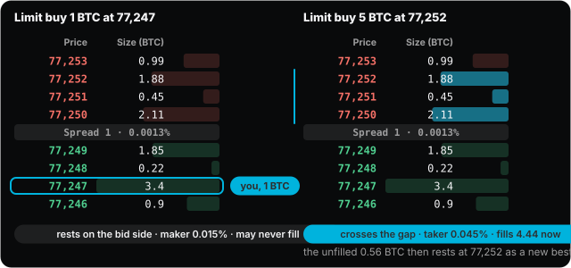

> **Try it on the site: Place a limit buy.** Slide your buy price up and down the ladder. The moment it reaches the best ask the order flips from resting to crossing, and the fee flips with it. [Open the sandbox](https://abilashsenth.github.io/Hyperliquid-Bootcamp/#layer-0/limit).

**Takeaway.** Whether a limit order waits or trades depends only on which side of the gap you put it.

<details><summary><b>Quick check.</b> You place a limit buy at 77,260 while the best ask is 77,250. What happens?</summary>

- a) It rests at 77,260 and waits for a seller
- b) It fills right away against the asks from 77,250 up to 77,260
- c) It is rejected for being above the market

**Answer: b.** A buy limit at or above the best ask can trade, so it does, walking up the asks until it is filled or reaches 77,260. Only a leftover would rest.

</details>

#### 7. Maker and taker: who pays what, and why

Every fill has two sides: an order that was already resting, and an order that arrived and hit it. The resting side **made** the market available; the arriving side **took** it. Exchanges charge the two differently, and Hyperliquid charges takers three times as much: at the base tier, **0.045% for a taker** and **0.015% for a maker**, on the dollar value of the fill.

On a 1,000-dollar fill that is 45 cents against 15 cents. Small, but it is charged on every fill, and a round trip is two fills. Over a hundred round trips the taker has paid 90 dollars and the maker 30, before any slippage.

Why reward the maker? A resting order is a gift to everyone else: a price anyone can trade at whenever they like, while its owner carries the risk of being picked off when news breaks. Venues pay for that service. The very largest makers are even paid to trade, a rebate instead of a fee.

Which orders are which is mechanical. A market order is always a taker. An IOC order (immediate or cancel: fill what you can now, cancel the rest) is a taker. A limit order is a maker if it rests and a taker if it crosses. A **Post Only** order (Hyperliquid calls it ALO) is the one that refuses to be a taker: if it would cross, it is rejected instead of filled.

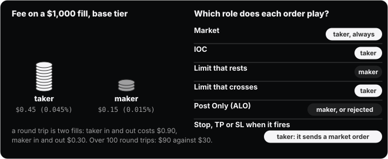

_The two fee rates as coins, and the role each order type plays. Fee tiers and staking discounts lower both numbers; Layer 2 has the full schedule._

**Takeaway.** Taker pays 0.045%, maker 0.015%. The difference is the price of impatience.

<details><summary><b>Quick check.</b> You place a limit buy below the best ask. Ten minutes later a seller comes down to it and it fills. Which fee did you pay?</summary>

- a) Both, because the order waited and then traded
- b) The taker fee, 0.045%
- c) The maker fee, 0.015%

**Answer: c.** Your order was resting when the trade happened, so you were the maker. The seller who came down to it was the taker.

</details>

#### 8. Price-time priority: the queue at each price

Several orders can rest at the same price. When a trade arrives, who fills first? On Hyperliquid, as on every serious exchange, the answer is **price first, then time**: the best price fills before any worse price, and at one price the order that arrived first fills first.

That turns each price level into a queue. When you place a limit order you join the back of the line at that price. Trades eat from the front. If a trade is smaller than the size ahead of you, you do not fill, however long you have waited.

There is one habit this punishes. If you cancel your order and place it again, even at the same price, you go to the back of the queue. Nudging an order a tick away and then back costs you your place twice.

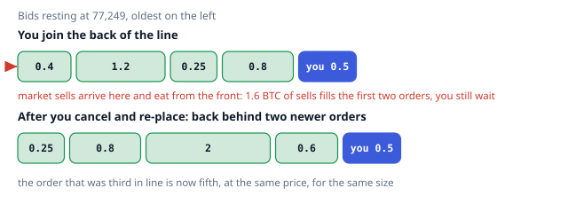

> **Try it on the site: The queue at 77,249.** Join the queue at the best bid, then let market sells arrive. Try “cancel and re-place” once and see where you land. [Open the sandbox](https://abilashsenth.github.io/Hyperliquid-Bootcamp/#layer-0/queue).

**Takeaway.** Your resting order is a place in a line. Changing it means leaving the line.

#### 9. Tick, lot and the ten-dollar floor

The book is a grid, not a continuum. Prices must sit on the **tick size**, the smallest allowed price step, and sizes on the **lot size**, the smallest allowed size step. Each asset has its own.

Hyperliquid’s rules for perps: a price may have up to **five significant figures**, and no more decimals than 6 minus the asset’s size decimals; whole-number prices are always allowed. For BTC the five-figure cap is what bites: a price like 77,250 already uses all five figures, so any decimal would be a sixth, and BTC prices are effectively whole dollars. For HYPE the decimals rule leaves room for four decimals, but the five-figure cap still applies: 84.571 is fine, 84.5712 is not. Sizes are rounded to the asset’s size decimals (five for BTC, two for HYPE). And every order must be worth at least **10 dollars**.

Get any of these wrong and the order is rejected, not rounded. It is the most common reason a first order on Hyperliquid “does nothing”.

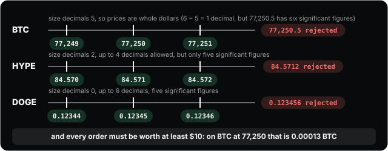

> **Try it on the site: Would the exchange accept this order?.** Pick an asset, type a price and a size, and see whether the exchange would accept them and why. The size decimals come from the exchange’s own asset list. [Open the sandbox](https://abilashsenth.github.io/Hyperliquid-Bootcamp/#layer-0/tick-lot).

**Takeaway.** Five significant figures, the asset’s size decimals, and ten dollars. Wrong rounding is rejected, not fixed.

#### 10. From the book to the chart

Every fill prints a trade: a price, a size, and which side was the taker. The **Trades** tab next to the book is that stream. Candles are a summary of it: over one window of time a candle records the first trade (open), the highest and lowest, and the last (close), and the volume bar underneath adds up the size that traded.

Notice the direction of time. The chart is made of trades that already happened. The book is the set of orders that might happen next. Charts summarise the past; the book is the only place the future is visible, and only a few seconds of it.

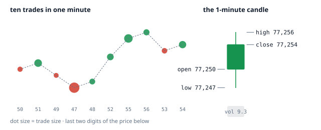

> **Try it on the site: Build a candle from trades.** Step through ten trades and watch the candle grow. Try to predict the next shape before you press the button. [Open the sandbox](https://abilashsenth.github.io/Hyperliquid-Bootcamp/#layer-0/candles).

**Takeaway.** A candle is the book’s history, compressed. The book is the chart’s next tick, uncompressed.

#### 11. The Hyperliquid trade screen, labelled

Here is where everything above lives on app.hyperliquid.xyz. The layout moves around as the team ships, so this is a map rather than a photograph.

Top strip: the asset, with mark price, oracle price, 24-hour change and volume, open interest, and the current funding rate with a countdown to the next payment. You will be able to read every one of those by the end of Layer 3. Centre: the chart. Right: the order book and the trades tape, with a grouping control that merges ticks so a tall book fits on one screen, and a toggle between size in coins and size in dollars. Far right: the order form. Bottom: your balances, positions, open orders, TWAPs, trade history, funding history and order history.

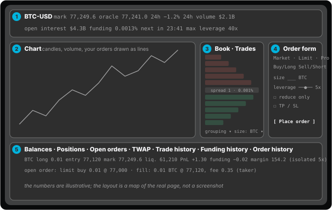

_1: the header, with the three prices, volume, open interest, funding and its countdown. 2: the chart, which is the past. 3: the book and the tape, the next few seconds, with the grouping control that merges ticks. 4: the order form; every order type in Layer 2 lives behind Market, Limit and Pro. 5: the bottom tabs, your positions with their liquidation price, your orders and your history._

**Takeaway.** Mark, oracle, funding, open interest, book, tape, form, positions. Eight words you will use every day.

#### 12. Why this book is different: it lives on a blockchain

On most exchanges the order book is a private database. On Hyperliquid it is the state of a blockchain, and every order, cancel and fill is a transaction that the **validators**, the computers that run the chain and vote on its state, agree on. The exchange half of that chain is called HyperCore; Layer 2 draws the map. Three consequences matter to you.

First, when the app tells you an order is filled it is already final: the response is the committed result, not a promise, and trading is gas-free. The chain handles about 200,000 orders a second with a median round trip of 0.2 seconds for a well-placed client. Second, within each block the chain sorts actions in a fixed order: things that are not new orders first, then cancels, then new orders, so a cancel sent in the same block as someone else’s market order wins. Third, everything is public. Every position, every liquidation and every trader’s history is readable by anyone, which becomes a research tool in Layer 6.

One more detail that saves confusion later: margin, the deposit that backs a position (Layer 4 is about it), is checked twice, when you place an order and again for the resting side at the moment it matches. A resting order that no longer has the margin behind it does not trade.


_The path of an order. The block sorts cancels ahead of new orders; the book matches by price and time; the result comes back committed; the state is public._

**Takeaway.** Committed, gas-free, cancels sorted first, and public. The book is a shared ledger, not a private database.

#### 13. Before you click: three questions

You now have everything the pass check for this layer asks for. Before any order, on any book, you should be able to answer three questions:

1. **Maker or taker?** If the order will cross the spread it is a taker and pays 0.045%. If it rests it pays 0.015%, but it might never fill.
2. **What will it really cost?** The fee, plus the spread if you cross, plus slippage if the order is bigger than the top level.
3. **How far will it move the price?** Read the depth. If your size is a large share of the first few levels, you are the move.

Then do the drills below on testnet. Reading this layer takes an hour; the drills are where it becomes a reflex.

**Takeaway.** Maker or taker, what it costs, how far it moves the price. Answer all three before every order, forever.

### Recap: the ideas in one line each

- Bid, ask, spread, mid. The spread is your first cost. On BTC it is usually one tick.
- Depth: the size resting at each level. A market order walks through levels, and the walk is slippage.
- Maker and taker. A limit order that rests is a maker and pays 0.015% at the base tier. Anything that crosses the spread is a taker and pays 0.045%. Market orders are always takers.
- Price-time priority: at one price, the earliest order fills first. Cancel and re-place and you go to the back of the queue.
- Tick and lot: prices must be multiples of the tick (perp prices carry at most 5 significant figures), sizes multiples of the lot, and every order is worth at least $10. Wrong rounding is rejected, not fixed.
- Candles and volume are the book’s history: a candle is the open, high, low and close of the trades in its window; volume is how much size crossed.

### Read: official docs

- [Order book (trading rules)](https://hyperliquid.gitbook.io/hyperliquid-docs/trading/order-book)
- [Order book under HyperCore (why it is on-chain, how orders are sequenced)](https://hyperliquid.gitbook.io/hyperliquid-docs/hypercore/order-book)
- [Tick and lot size](https://hyperliquid.gitbook.io/hyperliquid-docs/for-developers/api/tick-and-lot-size)

### Media for this layer

- **book** · Trading and Exchanges · Larry Harris, 2003
  Market microstructure for practitioners. Chapters 1 to 6 for why books behave as they do. Optional depth.

### Do

- [ ] Open BTC, then HYPE, on testnet. Watch each book for 10 minutes. Write down the spread, the size at the top three levels, and how often the best bid changes.
- [ ] Place a limit buy 1% below mid, then a market buy of the same size. Compare the fill price with the ask you saw, and the fee on each fill in trade history.
- [ ] Place a Post Only buy at the best ask. The rejection message is the maker/taker line in one sentence.

**Passed when:** For any order you are about to send, you can say whether it is maker or taker, what that costs, and roughly how far a market order of that size would move the price.

### Check yourself

1. A market buy larger than the size at the best ask fills at:
   - a) Successively worse levels until it is done
   - b) The mid price
   - c) The best ask only
2. Which order pays the maker fee?
   - a) A market order
   - b) A limit order that rests and later fills
   - c) An IOC order
3. Two orders at the same price. Who fills first?
   - a) Random
   - b) The larger one
   - c) The earlier one
4. Minimum order value on Hyperliquid:
   - a) $10
   - b) $100
   - c) $1
5. A Post Only buy placed at the best ask is:
   - a) Filled immediately
   - b) Rejected
   - c) Rested at the best bid

## Layer 1 · Perpetuals (the CSS of the stack)

**Goal.** Know what a perp is as a contract, and compute notional, margin, entry price and PnL by hand.

> A perp is a futures contract that never settles. Funding, not expiry, keeps it near spot, and everything odd about perps follows from that one substitution.

### The lesson

Layer 0 was the machine that matches buyers and sellers. This layer is about what, exactly, you are buying and selling on Hyperliquid: not coins, but contracts whose price follows a coin. Four ideas carry the whole layer: a perp is a future that never settles, long and short are mirror images, leverage changes your deposit and not your profit, and the entry price is an average of your opening fills.

_In the pictures, amber is spot or the oracle (the outside world’s price), white is the perp price, blue is you._

#### 1. Three ways to own a price

There are three ways to be exposed to the price of bitcoin. **Spot**: you buy the coin and hold it. The price is whatever the market says, you can never lose more than you paid, and there is nothing to maintain.

A **dated future** is a contract to settle on a date. Its price floats above or below spot, and the gap, called the **basis**, must shrink to zero by expiry because on that day the contract and the coin are the same thing. Futures let you take a position without holding the coin, and in either direction.

A **perpetual future**, a perp, is a future with the date removed. Nothing ever settles, so nothing forces its price back to spot. Instead there is an hourly payment between the people holding longs and the people holding shorts, called **funding**, that pays whichever side is needed to push the price back toward spot. Layer 3 does the arithmetic; for now the shape is enough.

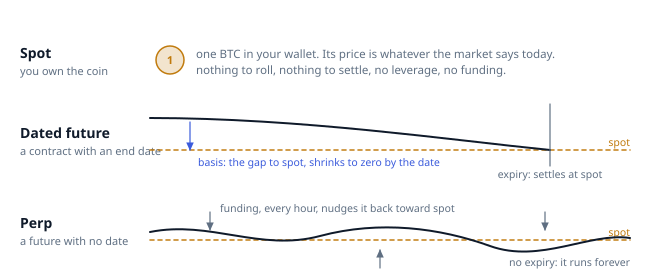

_Spot is ownership. A dated future converges to spot by its date. A perp never converges on its own, so funding keeps it tethered._

**Takeaway.** A perp is a futures contract that never settles. Funding replaces expiry, and everything odd about perps follows from that one substitution.

#### 2. Why a perp needs funding

Imagine the perp trading at 77,500 while bitcoin itself sits at 77,000. Nothing in the contract makes that gap close: there is no expiry day on which the two must meet. So the exchange charges the longs and pays the shorts, every hour, in proportion to how far above spot the perp sits. Holding the long now costs money, holding the short earns it, and people respond: longs close, shorts open, and the perp drifts back down.

When the perp is below spot the sign flips and shorts pay longs. The payment is never large in one hour, but it is relentless, and over days it is often the biggest cost in a trade that goes nowhere.

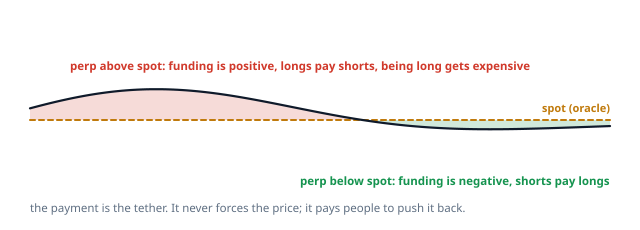

_Above spot, longs pay. Below spot, shorts pay. The payment goes peer to peer; the exchange keeps none of it._

**Takeaway.** Funding is a price for being on the crowded side. It does not force the perp to spot; it pays people to push it there.

#### 3. Long and short are mirror images

A **long** profits when the price rises and loses when it falls. A **short** is the same contract with the sign flipped: it profits when the price falls. On a perp nothing is borrowed or lent to go short; both sides simply post margin and the exchange keeps score between them.

This matters more than it sounds. On spot, “selling” means you no longer have a position. On a perp, selling when you are flat opens a short, which is a position with risk in the other direction. The order form says Sell / Short for exactly that reason.

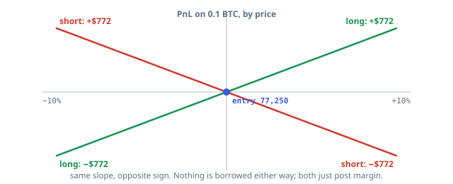

_The same 0.1 BTC position as a long and as a short. Every dollar one makes, the other loses._

**Takeaway.** A short is a position whose PnL rises as the price falls. On a perp, selling while flat opens one.

<details><summary><b>Quick check.</b> You are flat and you press Sell / Short for 0.1 BTC. What do you have?</summary>

- a) Nothing: you had no position to sell
- b) A short position that profits if the price falls
- c) An error, because you cannot sell what you do not own

**Answer: b.** On a perp, selling while flat opens a short. Nothing is borrowed; you post margin and gain as the price falls.

</details>

#### 4. Notional, margin, leverage

Three numbers describe every position. **Notional** is the full size of the exposure: size × price, so 0.1 BTC at 77,250 is a 7,725-dollar position whatever you paid for it. **Margin** is the deposit you post to hold it. **Leverage** is the ratio of the two: notional ÷ margin.

On Hyperliquid you choose leverage as a whole number from 1 up to the asset’s maximum, which ranges from 3x to 40x depending on the coin (BTC 40x, ETH 25x, SOL 20x, HYPE and most alts 10x in November 2026). The exchange checks the leverage only when you open or add to a position; after that, your margin and the mark price do the talking.

Here is the thing newcomers get backwards. Leverage does not change how much you make on a move. A 1% move on a 7,725-dollar position is 77.25 dollars at 1x, at 5x and at 20x. What leverage changes is how much of your own money is behind the position, and therefore how small a move wipes that money out. Drag the sliders and watch the PnL column refuse to change.

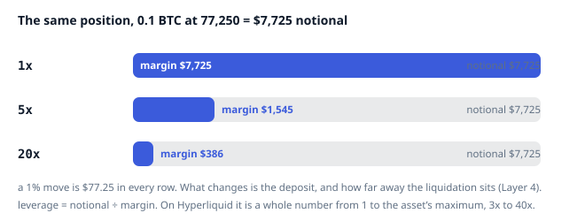

> **Try it on the site: Same position, three leverages.** Change the leverage and watch which numbers move. Profit and loss depend only on size and the price move; margin and return on margin depend on leverage. [Open the sandbox](https://abilashsenth.github.io/Hyperliquid-Bootcamp/#layer-1/notional).

**Takeaway.** Leverage is notional ÷ margin. It sets your deposit and your distance to the cliff, not your profit on a move.

#### 5. Entry price: the average of your opening fills

A position is usually built from several fills, often at several prices. The exchange keeps one number for it: the **entry price**, the size-weighted average of every fill that opened or added to the position.

The rule has two halves. A fill that increases the position (buying when long, selling when short) is an **opening** fill and moves the entry price toward its own price, weighted by size. A fill that shrinks the position is a **closing** fill and leaves the entry price exactly where it was; its profit or loss becomes closed PnL instead.

So adding to a winner raises your entry, adding to a loser lowers it, and taking profit changes nothing about the fills that remain. The sandbox lets you press fills in any order and watch the number.

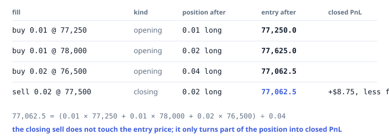

> **Try it on the site: Build a position and watch the entry price.** Press the fills in any order. Opening fills move the entry; the closing fill does not. [Open the sandbox](https://abilashsenth.github.io/Hyperliquid-Bootcamp/#layer-1/entry).

**Takeaway.** Opening fills move the entry price toward themselves, weighted by size. Closing fills never touch it.

<details><summary><b>Quick check.</b> You are long 0.02 BTC with an entry of 77,062.5. You sell 0.01 at 78,000. Your entry price is now:</summary>

- a) 77,531.25, the new average
- b) 77,062.5, unchanged
- c) 78,000, the last fill

**Answer: b.** Closing fills never touch the entry price. The 0.01 you sold realises (78,000 − 77,062.5) × 0.01 as closed PnL, and the remaining 0.01 keeps its entry of 77,062.5.

</details>

#### 6. PnL, unrealized and closed

**Unrealized PnL** is what the position would be worth if closed at the current mark price: side × (mark − entry) × size, with side +1 for a long and −1 for a short. It uses the **mark price** (Layer 3), not the last trade, which is why the number can tick while the book is quiet.

**Closed PnL** is booked on each closing fill: side × (fill price − entry) × the size closed, minus the fee. On an opening fill nothing is realised yet, so closed PnL is just the fee, shown as a small negative number before the price has moved at all.

Hyperliquid’s docs say something worth remembering: entry price, unrealized PnL and closed PnL are conveniences computed by the front end. The accounting that matters, the thing that can liquidate you, is margin against the mark price, and Layer 4 is about that.

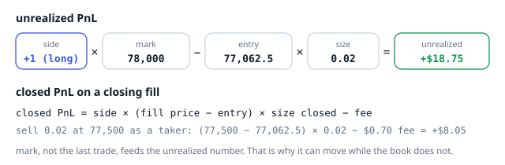

_The two formulas with the numbers from the previous section. The 70-cent fee is the taker rate on a 1,550-dollar fill._

**Takeaway.** Unrealized PnL = side × (mark − entry) × size. Closed PnL includes the fee, so a fresh position starts slightly negative.

#### 7. USDC in, USDT prices: the tiny permanent gap

Your collateral is USDC, but the oracle that prices most perps is built from spot markets on other exchanges that are quoted in USDT, and the exchange applies no conversion between the two. In the jargon this makes the contracts **quanto**: priced in one unit, settled in another.

In practice it means the mark price you see can sit a few dollars from the dollar price on a USD venue, permanently, because USDT and USDC rarely trade at exactly one to one. It is not an arbitrage, it is not a bug, and it is not a signal. HYPE and PURR are quoted in USDC directly and do not have the gap.

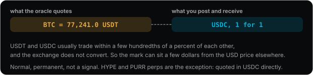

_The oracle speaks USDT, the collateral is USDC, and nothing converts between them._

**Takeaway.** Prices are USDT, collateral is USDC, and the small permanent gap between mark and the USD price elsewhere is normal.

#### 8. Why perps took over crypto

Dated futures need rolling: every quarter you close one contract and open the next, paying fees and spread each time. A perp needs nothing. One contract per asset means one deep book instead of several shallow ones. Leverage is symmetric, so going short is as easy as going long. And the market never closes.

The cost of all that convenience is the funding payment and the margin engine, which is why the next three layers exist. A trader who understands those two things has understood perps; the rest is practice.

**Takeaway.** No expiry to roll, one book per asset, leverage both ways, 24/7. The price of that is funding and liquidation, which are Layers 3 and 4.

#### 9. The drill, on paper first

Before you touch testnet, do the arithmetic the first drill asks for, by hand, with the prices of the day. Here it is with the November 2026 prices in this lesson:

1. **0.01 BTC long at 77,250, 3x.** Notional = 0.01 × 77,250 = $772.50. Margin = 772.50 ÷ 3 = $257.50. At +1% (78,022.5) the unrealized PnL is +$7.73; at −1% it is −$7.73.
2. **0.5 SOL short at 162.34, 3x.** Notional = 0.5 × 162.34 = $81.17. Margin = $27.06. At +1% the short shows −$0.81; at −1% it shows +$0.81.
3. **Add to the BTC long:** buy another 0.01 at 78,000. New entry = (0.01 × 77,250 + 0.01 × 78,000) ÷ 0.02 = 77,625. Close 0.01 later and the entry stays 77,625.

Now open the same positions on testnet, cover the position panel with your hand, and compare. If your numbers match to the cent, the pass check for this layer is honest.

**Takeaway.** Notional, margin, entry and PnL from the fills alone, before looking at the panel. That is the whole layer.

### Recap: the ideas in one line each

- Spot: you own the coin. Dated future: a contract to settle on a date; it trades above or below spot (the basis) and converges at expiry. Perp: a future with no date; an hourly payment between longs and shorts (Layer 3) replaces convergence.
- Long and short are symmetric. A short is a position whose PnL rises as price falls. Nothing is borrowed, nothing is lent.
- Notional = size × price. Margin = what you post. Leverage = notional / margin. On Hyperliquid leverage is an integer from 1 to the asset’s maximum (BTC 40x, ETH 25x, SOL 20x, HYPE and most alts 10x as of November 2026) and is checked only when you open.
- Entry price is the size-weighted average of your opening fills; closing fills never change it. Unrealized PnL = side × (mark − entry) × size, with side +1 for a long and −1 for a short. Closed PnL includes the fee.
- Collateral is USDC but most oracle prices are quoted in USDT, so contracts are technically quanto. That is the tiny permanent gap between mark and the spot price you see elsewhere.
- Why perps won crypto: no expiry to roll, one book per asset, leverage both ways, 24/7.

### Read: official docs

- [Perpetual assets](https://hyperliquid.gitbook.io/hyperliquid-docs/trading/perpetual-assets)
- [Contract specifications](https://hyperliquid.gitbook.io/hyperliquid-docs/trading/contract-specifications)
- [Entry price and PnL](https://hyperliquid.gitbook.io/hyperliquid-docs/trading/entry-price-and-pnl)
- [Hyperliquid 101 for non-crypto audiences](https://hyperliquid.gitbook.io/hyperliquid-docs/about-hyperliquid/hyperliquid-101-for-non-crypto-audiences)

### Media for this layer

- **article** · [Perpetuals 101](https://thiccy.substack.com/p/perpetuals-101) · Thiccy (Substack), Jun 2023, 4 min
  The cleanest short explanation of why a perp needs funding and how basis arbitrage pulls it back to the index. Read it before the Hyperliquid docs, then read the docs for the exact formulas.
  _opened 3 Nov 2026_ · _No promotion, no paywall_ · _One worked example has a $5 vs $1 typo; the logic is right_
- **podcast** · [Jeff Yan on how Hyperliquid works, Bloomberg Odd Lots](https://podscripts.co/podcasts/odd-lots/jeff-yans-plan-to-bring-the-entire-financial-industry-onto-hyperliquid) · Joe Weisenthal and Tracy Alloway, 15 Oct 2026
  The founder explaining the order book, collateral, oracle-tracked contracts, funding and the validator set to a non-crypto audience. The best single hour of context for Layers 1 to 3.
  _opened 3 Nov 2026_ · _Transcript link; the audio is on any podcast app under Odd Lots_ · _Also on Bloomberg video, same date_
- **interview** · [Exclusive interview with Hyperliquid founder Jeff](https://wublock.substack.com/p/exclusive-interview-with-hyperliquid) · WuBlockchain (Colin Wu), 17 Aug 2025, text
  Why the team is small, why there was no venture or market-maker deal, and why the core is meant to run itself. Explains the design choices you will trade against.
  _opened 3 Nov 2026_ · _Free, no paywall seen_
- **podcast** · [Jeff Yan on Hyperliquid’s plan to bring all finance onchain, Empire](https://blockworks.com/podcast/empire/bc375300-c276-11f1-925c-cbee0c7ea3ff) · Blockworks, 7 Oct 2026, about 30 min
  Institutional access, the cost of speed, options and whether transparent books give better execution. Listen after Odd Lots if you want the builder-side view.
  _opened 3 Nov 2026_ · _Episode page carries conference discount codes; no product pitch in the content_

### Do

- [ ] Open a 0.01 BTC long and a 0.5 SOL short at 3x on testnet. Before looking at the position panel, compute notional, margin, and PnL at +1% and −1%. Check.
- [ ] Add to the long at a different price. Recompute the entry price by hand. Check.
- [ ] Close half the long. Confirm the entry price did not move and that closed PnL includes the fee.

**Passed when:** You can fill in notional, margin, leverage, entry and PnL for any position from the fills alone.

### Check yourself

1. A perp differs from a dated future mainly because:
   - a) It settles every day
   - b) It has no expiry and funding keeps it near spot
   - c) It allows less leverage
2. Notional of 0.5 BTC at $80,000:
   - a) $160,000
   - b) $20,000
   - c) $40,000
3. Your entry price changes on:
   - a) Opening fills
   - b) Funding payments
   - c) Closing fills
4. Unrealized PnL on Hyperliquid is computed from:
   - a) Last trade
   - b) Mark price
   - c) Oracle price
5. On Hyperliquid, leverage is checked:
   - a) At each funding print
   - b) Continuously
   - c) Only when you open or increase a position

## Layer 2 · The Hyperliquid machine (the JavaScript of the stack)

**Goal.** Use every part of the trading screen on purpose, and know what each order type does under stress.

> Trading is gas-free and the response you get back is the committed result, not a promise. Because the book is on-chain, every position and liquidation is public, which Layer 6 uses.

### The lesson

Layers 0 and 1 were about markets in general. This one is about the machine you will actually use: how to get onto it safely, what every control on the order form does, and what each order type does when the market is moving against you. There is a lot of detail here. You do not need to memorise it; you need to have met each piece once, so that the drills (every order type, once, on testnet) make sense.

_In the pictures, blue is you or your order, amber is an external reference such as the oracle or a watermark, red and green are the sell and buy sides._

#### 1. Two halves of one chain

Hyperliquid is its own blockchain, and it has two halves. **HyperCore** is the exchange: an order book for every asset, the clearinghouse that holds margin and positions, the oracle, spot markets, staking and vaults. **HyperEVM** is an Ethereum-style chain for apps that can read and write HyperCore. Everything a manual trader does happens in HyperCore, through the app, and you never need to touch the EVM side.

Under both sits one consensus (HyperBFT) that agrees the order of every transaction. That is what makes the book in Layer 0 a shared ledger rather than a private database: about 200,000 orders a second, a median round trip of 0.2 seconds, and a committed answer to every order you send.

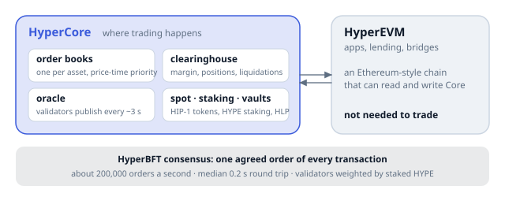

_HyperCore is where you trade. HyperEVM is where apps live. One consensus under both._

**Takeaway.** You trade on HyperCore, through the app. HyperEVM exists; you do not need it.

#### 2. Getting set up, in five steps

The order matters, because the testnet faucet only pays an address that has already deposited on mainnet. So day one is: a fresh wallet used only for this; a small mainnet deposit (about 10 USDC on Arbitrum, plus a little ETH there for gas) which also pays the one-time 1 USDC activation fee; the testnet faucet, which drips 1,000 mock USDC to the same address; one gas-free signature to enable trading; and then testnet until Layer 7.

Use a wallet, not email login. Email login (through Privy) creates different addresses on mainnet and testnet, which breaks the faucet rule; the docs explain how to export an email wallet if you already have one. Keep the seed phrase offline; anyone with it has your funds.

The step-by-step list with exact URLs is in the “Setup, once” box below the lesson.

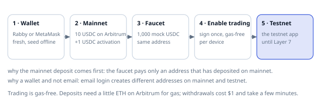

_Five steps, in this order, because the faucet checks for a mainnet deposit from the same address._

**Takeaway.** Fresh wallet, 10 USDC on mainnet, faucet, enable trading, testnet. Email login breaks the faucet rule.

#### 3. The order form, decoded

Every order you will ever place goes through one small panel. Across the top: **Market**, **Limit** and **Pro**, where Pro hides the rest (Scale, TWAP, Stop and Take orders, Chase, Trailing stop). Then the direction: Buy / Long or Sell / Short, which, as Layer 1 warned, opens a short if you are flat.

Size can be typed in coins or in dollars, and the slider underneath sets it as a share of your available margin, which is a dangerous default for a learner: it thinks in leverage, not in risk (Layer 4 teaches the other way round: stop first, then size). The margin mode (cross or isolated) and the leverage number sit together, because together they decide how far away your liquidation is (Layer 4). Reduce Only means the order can only shrink an existing position. The TP/SL box attaches exits to the order you are placing.

Under the button is the line that matters most and is read least: order value, margin required, estimated slippage and the fee. Make a habit of reading it before every click.

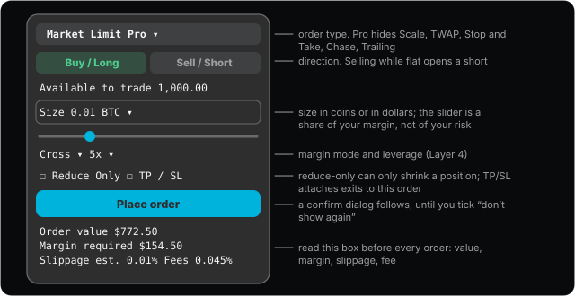

_The order form as a schematic. The real one rearranges itself with releases, but every control here will be somewhere on it._

**Takeaway.** Type the size, never slide it. Read the value, margin, slippage and fee line before you click.

#### 4. Where each order type sits relative to the price

The easiest way to keep the order types straight is to place them on a price ladder. To open a long you have three choices. A **limit buy** rests below the mid and waits for the price to come down to it. A **stop market buy** has a trigger above the mid: it does nothing until the mark price rises to the trigger, then sends a market buy, the classic breakout entry. A **take market buy** has a trigger below the mid: it fires when the mark falls to it, a dip entry. Stop limit and take limit are the same triggers sending a limit order instead of a market order.

To manage a long you have the mirror image. A **take profit** sells when the mark rises to its trigger; a **stop loss** sells when the mark falls to its trigger; a **trailing stop** is a stop loss whose trigger follows the highest mark reached and never moves back down.

The rule hidden in all of that: every triggered order is a market order in waiting. It fires on the mark price, not on the last trade, and when it fires it pays the taker fee.

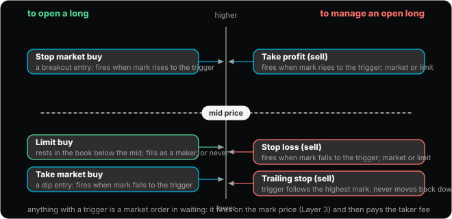

> **Try it on the site: When does a trigger order fire?.** Pick an order, set its trigger, and press play. Watch which line crosses the trigger. The last trade on Hyperliquid often has not reached it when the order fires. [Open the sandbox](https://abilashsenth.github.io/Hyperliquid-Bootcamp/#layer-2/order-map).

**Takeaway.** Triggers above the mid for stop buys and take-profit sells; below the mid for take buys and stop-loss sells. All of them fire on mark.

#### 5. Triggers fire on mark, not on the last trade

Layer 3 builds the **mark price** properly. For now you need one fact: mark is mostly made from prices on other exchanges, smoothed, and only partly from Hyperliquid’s own book. So a sharp move on Binance moves the mark here within seconds, whether or not anyone has traded at that price on Hyperliquid. If your stop trigger sits in the way, it fires.

What happens next depends on the kind of TP/SL. A **market** TP/SL sends a market order with a 10% slippage tolerance, which almost always fills, at whatever the book offers. A **limit** TP/SL sends a limit order at the price you set, which caps your slippage but might not fill at all if the market gaps through it. The docs’ example: a stop with a $10 trigger and a $10 limit may sit unfilled if the price jumps from $11 to $9; with an $8 limit it fills somewhere between $9 and $8.

A stop is insurance, and insurance that might not pay out is not insurance. Use a market stop unless you have a specific reason not to, and keep its size small enough that 10% slippage would be survivable.

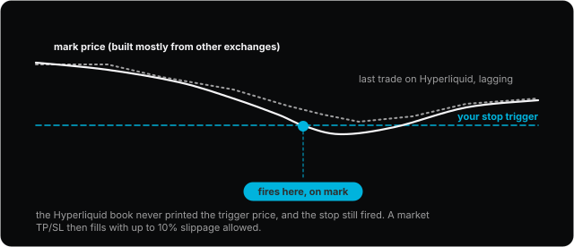

_The mark line reaches the trigger before the Hyperliquid tape does. The stop fires anyway._

**Takeaway.** A stop can fire at a price that never traded here. Market stops fill with up to 10% slippage; limit stops may not fill at all.

<details><summary><b>Quick check.</b> Your stop loss on a long has a trigger of 76,000. The last trade on Hyperliquid is 76,180, but mark drops to 75,990. What happens?</summary>

- a) Nothing until a trade prints at 76,000 on Hyperliquid
- b) The stop fires, because triggers use the mark price
- c) The stop is cancelled for being stale

**Answer: b.** TP/SL orders trigger on mark, which is built mostly from other exchanges. The Hyperliquid tape is irrelevant to whether it fires.

</details>

#### 6. TP/SL: on a position, or tied to an order

There are two places to attach a take profit or stop loss, and they behave differently. A **position** TP/SL, set from the positions table, defaults to the whole position and keeps covering it as the position grows or shrinks, unless you type a fixed size, in which case it stays fixed.

An **order-tied** TP/SL, set from the order form while placing an entry, is sized to that order and only comes alive when the parent order fills completely. The two children are an OCO pair: one cancels the other. If the parent only partly fills, the children are not placed yet, so the filled part has no stop. And if you cancel the parent, the children go with it, even if part of the parent had filled. That last case is the one that catches people: cancel a half-filled entry and your half position is suddenly naked.

The drill asks you to do this on purpose on testnet, once, so you feel it.


_A parent order with its OCO children, and the three outcomes that decide whether the children exist._

**Takeaway.** Position TP/SL follows the position. Order-tied TP/SL lives and dies with its parent order.

<details><summary><b>Quick check.</b> You set a TP/SL from the positions table without typing a size, then add to the position. What does the TP/SL cover now?</summary>

- a) The whole position, because a position TP/SL follows the position unless you fixed its size
- b) Only the size you had when you set it
- c) Nothing: any change to the position cancels it

**Answer: a.** A position TP/SL defaults to the entire position and keeps covering it as it grows or shrinks. Only a TP/SL with a typed size stays fixed.

</details>

#### 7. GTC, IOC, ALO and reduce-only

Limit orders carry a time-in-force that says what to do if they cannot fill at once. **GTC** (good till cancelled) rests in the book until filled or cancelled; it is the default. **IOC** (immediate or cancel) fills whatever it can right now and cancels the remainder; it is the honest version of a market order, because you name the worst price you accept. **ALO** (add liquidity only), which the app calls Post Only, is the opposite: if the order would fill right now it is rejected; it only ever rests, so it only ever pays the maker fee.

**Reduce only** is a separate switch that works with any of them: the order can shrink your position but never open or flip one. Put it on every exit. It is the cheapest insurance there is against the fat-finger that turns “close my long” into “open a short twice the size”.

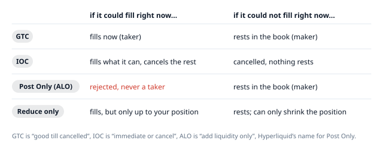

_What each option does in the two situations that matter: the order could fill now, or it could not._

**Takeaway.** GTC rests, IOC fills and cancels, Post Only rests or is rejected. Reduce-only on every exit.

#### 8. Big orders: scale, TWAP and chase

Three tools exist for orders too large to send in one piece. **Scale** places a ladder of limit orders across a price range, so you accumulate as the price moves through them instead of guessing one level. **TWAP** slices a large order into small market orders sent at regular intervals: the interval is at least 30 seconds, the running time between 5 minutes and 7 days, the total at least $100, and each slice is capped at 3% slippage. If a slice misses because the spread is wide, later slices grow to catch up, up to three times the normal size. TWAP slices pause during a network upgrade.

**Chase** is a Post Only order that keeps re-pricing itself to sit one tick inside the best bid (or ask), so it stays at the front of the queue and always fills as a maker. It runs in your browser tab, not on the exchange: close the tab, switch address, or modify the order and it stops. Up to five can run at once.

At learner size none of these is necessary. They are here so that the Pro tab is not a mystery, and so that when you see a wall of small prints every 30 seconds on the tape, you know what you are looking at.

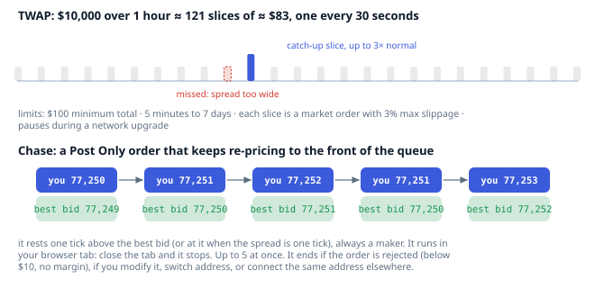

_A TWAP’s slices across an hour, with a missed slice and its catch-up; a chase order re-pricing behind a moving best bid._

**Takeaway.** Scale is a ladder of limits, TWAP is slices over time, chase is a maker order that follows the best price from your browser.

#### 9. Trailing stops: the watermark and the retracement

A trailing stop closes a position when the price turns against it by a set amount after moving in its favour. For a long, the order tracks the **highest mark price** since it activated (the watermark) and triggers a market sell when the mark falls from that high by your **retracement**, set as a distance or a percentage. The trigger only ever moves up, never down.

The docs’ example: long, mark at 100, retracement 10. The trigger starts at 90. Mark goes to 110, the trigger lifts to 100. Mark dips to 105, the trigger stays at 100. Mark climbs to 120, the trigger lifts to 110. Mark falls to 110 and the position is sold at market. An optional activation price delays the tracking until the market has reached a level you choose.

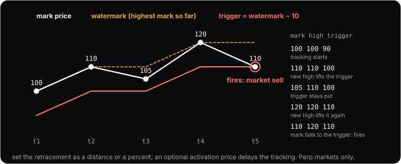

_The docs’ Example 1 drawn out: the watermark rises with each new high, the trigger follows ten below it, and the stop fires at 110._

**Takeaway.** A trailing stop follows the best mark by your retracement and never moves backwards. It fires on mark, as a market order.

#### 10. Fees, the full picture

Layer 0 gave you the two numbers that matter at the start: 0.045% taker and 0.015% maker on perps. The full schedule steps those down with your 14-day volume (spot counts double), with tiers at $5M, $25M, $100M, $500M, $2B and $7B, recomputed at the end of each UTC day. Staking HYPE discounts whatever tier you are in: 5% off at more than 10 HYPE, up to 40% at more than 500,000. A referral code takes 4% off your first $25M of volume. Spot is dearer, 0.07% and 0.04% at the base.

None of the fee goes to a team. It is paid to HLP, the community vault you will meet in Layer 8, and to the assistance fund, which buys and burns HYPE. The [Tools page](https://abilashsenth.github.io/Hyperliquid-Bootcamp/#tools) has a fee calculator that applies the tier, referral and staking discounts to a round trip, and the drill asks you to reconcile one real fill against it.

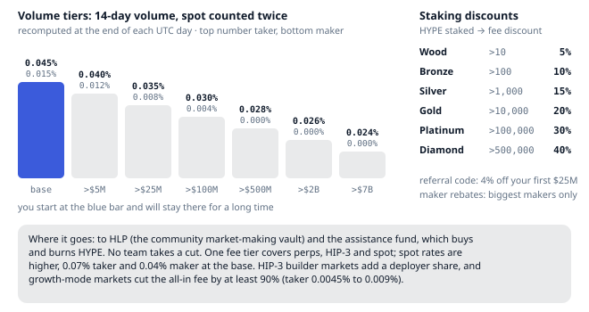

_The volume staircase, the staking discounts, the referral discount, and where the money goes._

**Takeaway.** You will live at the base tier for a long time: 0.045% and 0.015%. A referral code and staking are the only discounts that apply to you.

#### 11. Gas-free, committed, and public

Three practical consequences of the chain under the app. First, trading costs no gas and every response is final; the only chain costs you meet are the 1 USDC activation on your first deposit, the gas to deposit from Arbitrum, and the $1 withdrawal fee. Second, during a network upgrade, which the team announces on X and Discord, there is a short window in which only Post Only orders are accepted and nothing matches: a market stop that triggers inside it waits until the window ends, and TWAPs pause. Do not plan an exit through an upgrade. Third, everything is public: positions, fills, liquidations, and the leaderboard of who is making and losing money. Layer 6 turns that into a research tool.

**Takeaway.** No gas, final answers, a window during upgrades in which nothing matches, and a public ledger of everyone’s positions.

#### 12. The drills, in order

The first drill says “every row of the order table, once”. Do them in this order, each with one line in your notes about what you expected and what happened:

1. Market buy, then market sell, smallest size. Find both fees in trade history.
2. Limit buy 1% below the mid (watch it rest), then a limit buy at the best ask (watch it cross). Note which fee each paid.
3. Post Only buy at the best ask. Read the rejection.
4. IOC buy for more than the top level holds. See the partial fill and the cancelled remainder.
5. Open a small long, then set a position TP/SL. Then place a new entry with an order-tied TP/SL, let it half fill, cancel it, and watch the children vanish.
6. Stop market buy above the mid and take market buy below it; wait for one to fire. Confirm it fired on mark.
7. A reduce-only sell larger than your position. Note what fills.
8. Scale, TWAP ($100 minimum, 5 minutes), chase and trailing stop, once each, just to see them run.

When that list is done, the pass check for this layer is honest: you can place any row of the table without reading, and you know which orders trigger on mark and which fill against the book.

**Takeaway.** Every order type once, on testnet, with a note. That is how the table becomes reflex.

### Setup, once

1. Wallet: Rabby or MetaMask, a fresh wallet used only for this, seed phrase offline. Email login works but gives different addresses on mainnet and testnet, so use a wallet.
2. Mainnet: deposit about 10 USDC on Arbitrum (keep a little ETH there for gas). The first deposit pays a 1 USDC activation fee. This unlocks the testnet faucet.
3. Testnet: app.hyperliquid-testnet.xyz/drip pays 1,000 mock USDC to an address that has deposited on mainnet.
4. Click Enable Trading and sign the gas-free message. Withdrawals back to Arbitrum cost $1 and take a few minutes.

### Order types, as a table

| Type | What it does | The rule to remember |
| --- | --- | --- |
| Market | Fills now against the book | Always a taker; set your slippage tolerance |
| Limit (GTC) | Rests until filled or cancelled | Maker if it rests, taker if it crosses |
| Post Only (ALO) | Rests, or is rejected | Never pays the taker fee |
| IOC | Fills what it can now, cancels the rest | The honest market order |
| Reduce Only | Can only shrink a position | Use it on every exit |
| Stop market / stop limit | Fires when mark hits the trigger | Buy stops sit above the mid, sell stops below |
| Take market / take limit | Fires when mark hits the trigger | Buy takes sit below the mid, sell takes above |
| TP/SL on a position | Market order on trigger, 10% slippage tolerance, mark-triggered | Market unless you have a reason; a limit TP/SL caps slippage but may not fill |
| Trailing stop | Follows the best mark by a distance or percent | Perps only; never moves backwards |
| Scale | A ladder of limits across a price range | Spreads entries without babysitting |
| TWAP | Slices every 30 s or more, 5 min to 7 days, $100 minimum, 3% slippage per slice | Catch-up slices grow to 3x; pauses during network upgrades |
| Chase | Post Only that re-prices to sit one tick inside the best bid or ask (at it when the spread is one tick) | Runs in your browser tab; 5 at a time |

### Fees, in one paragraph

0.045% taker and 0.015% maker at tier 0; spot 0.07% and 0.04%. Tiers step at $5M, $25M, $100M, $500M, $2B and $7B of 14-day volume (spot counts double), recomputed at the end of each UTC day. Staking HYPE discounts fees from 5% (more than 10 HYPE) to 40% (more than 500,000). A referral code discounts your first $25M of volume. Fees go to HLP and the assistance fund, not to a team.

### Read: official docs

- [How to start trading](https://hyperliquid.gitbook.io/hyperliquid-docs/onboarding/how-to-start-trading)
- [Testnet faucet](https://hyperliquid.gitbook.io/hyperliquid-docs/onboarding/testnet-faucet)
- [Order types](https://hyperliquid.gitbook.io/hyperliquid-docs/trading/order-types)
- [Take profit and stop loss orders](https://hyperliquid.gitbook.io/hyperliquid-docs/trading/take-profit-and-stop-loss-orders-tp-sl)
- [Fees](https://hyperliquid.gitbook.io/hyperliquid-docs/trading/fees)
- [Miscellaneous UI](https://hyperliquid.gitbook.io/hyperliquid-docs/trading/miscellaneous-ui)
- [Portfolio graphs](https://hyperliquid.gitbook.io/hyperliquid-docs/trading/portfolio-graphs)
- [FAQ: My TP/SL did not execute correctly](https://hyperliquid.gitbook.io/hyperliquid-docs/support/faq/trade-outcome-looks-incorrect/my-tp-sl-did-not-execute-correctly)
- [FAQ: Why was my chase order canceled?](https://hyperliquid.gitbook.io/hyperliquid-docs/support/faq/trade-outcome-looks-incorrect/why-was-my-chase-order-canceled)
- [FAQ: Trailing stops](https://hyperliquid.gitbook.io/hyperliquid-docs/support/faq/trailing-stops)

### Media for this layer

- **official** · [@HyperliquidX on X](https://x.com/HyperliquidX) · Official account
  Upgrades, listings, delistings and incidents are posted here first. Follow it and turn on notifications; it is the only account you need for news.
  _seen in search results, not opened_ · _Impersonators DM people; the real account never DMs_
- **official** · [Hyperliquid Discord](https://discord.com/invite/hyperliquid) · Official community
  Announcements and support. Use the link in the app footer rather than any link in a search result or DM.
  _seen in search results, not opened_ · _Invite seen on a community wiki, not an official page; verify from app.hyperliquid.xyz_

### Do

- [ ] Execute every row of the order table once on testnet, each with a line on what you expected and what happened.
- [ ] Set a position TP/SL, then an order-tied (OCO) TP/SL. Cancel a partially filled parent and watch its children vanish. That is the rule that bites people.
- [ ] Find the fee on one fill in trade history and reconcile it to the schedule.

**Passed when:** You can place any row of the order table without reading, and you know which orders trigger on mark and which fill against the book.

### Check yourself

1. TP/SL orders on Hyperliquid trigger on:
   - a) Oracle price
   - b) Last traded price
   - c) Mark price
2. Slippage tolerance on a market TP/SL:
   - a) 10%
   - b) None, it is a limit
   - c) 1%
3. You cancel a partially filled parent order that has OCO children. The children:
   - a) Stay active
   - b) Are cancelled too
   - c) Are placed immediately
4. Tier-0 perps fees, taker and maker:
   - a) 0.10% and 0.02%
   - b) 0.02% and 0.00%
   - c) 0.045% and 0.015%
5. TWAP minimum total size and smallest slice interval:
   - a) $100 and 30 s
   - b) $1,000 and 60 s
   - c) $10 and 10 s

## Layer 3 · Prices and funding

**Goal.** Know which of the three prices does what, and compute what a position costs to hold.

> Your stop can fire at a price that never traded here. Triggers and liquidations use mark, and mark is built mostly from other exchanges.

### The lesson

Hyperliquid shows you three prices for every asset, and the one you watch most, the last trade, is the one the exchange cares about least. This layer builds the other two from scratch: the oracle, which sets funding, and the mark, which decides liquidations and triggers. Then it takes funding apart, formula and all, and turns it into dollars per day, which is the number you will actually use.

_In the pictures, amber is the oracle or anything from outside Hyperliquid, white is the mark, grey dashes are Hyperliquid’s own book, blue is you._

#### 1. Three prices on one screen

Open any market and the header shows a **mark** price and an **oracle** price; the book and the tape show the **last trade** and the mid. They are rarely identical, and each has a job.

The last trade and mid are just what Hyperliquid’s own book did a moment ago. They are for display. The oracle is the outside world: a weighted median of the coin’s spot price on the big exchanges, published by the validators about every three seconds. It is used to compute funding. The mark is the exchange’s best estimate of the fair perp price, built from the oracle, Hyperliquid’s own book, and other exchanges’ perps, and it is used for everything that matters: liquidations, TP/SL triggers, unrealized PnL and margin checks.

The practical consequence came up in Layer 2 and is worth repeating: things happen to your position at the mark price, which can differ from any price on your screen’s tape by a few ticks for minutes at a time.

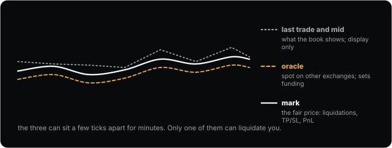

_The three prices over the same minutes. The grey dashes are the tape, the amber dashes the oracle, the white line the mark._

**Takeaway.** Last is for looking at. Oracle sets funding. Mark decides liquidations, triggers and PnL.

#### 2. The oracle: a weighted median of other exchanges

Every validator watches the spot price on eight sources and publishes a weighted median: Binance counts three times, OKX and Bybit twice each, Kraken, KuCoin, Gate, MEXC and Hyperliquid’s own spot once each. For a coin whose real market is elsewhere, like BTC, Hyperliquid’s spot is left out; for a coin born here, like HYPE, outside sources are left out until they are liquid. The chain then takes a median across all the validators’ numbers, weighted by **stake**, the amount of HYPE each validator has locked up to earn the right to run the chain, so a bigger validator counts for more. The result is the oracle price, refreshed about every three seconds.

A **median** is the point with half the weight below it and half above. The reason it is used instead of an average is that it ignores outliers: one exchange printing a bad tick, or one validator submitting a bad number, cannot move it unless more than half the weight agrees. Push Binance’s price around in the sandbox and watch the oracle shrug.

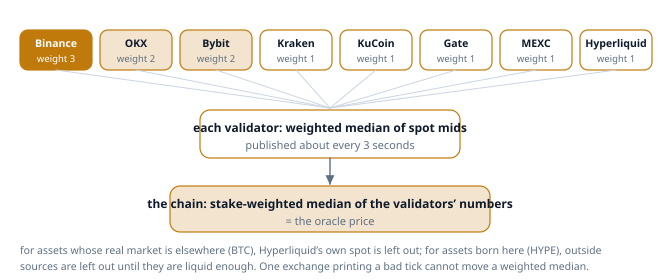

> **Try it on the site: Push one exchange, watch the oracle.** Drag one exchange’s price away from the others. The average follows it; the weighted median barely moves until the push is enormous. [Open the sandbox](https://abilashsenth.github.io/Hyperliquid-Bootcamp/#layer-3/oracle).

**Takeaway.** The oracle is a stake-weighted median of weighted medians. Nothing that happens on Hyperliquid’s own BTC book can move it.

#### 3. The mark price: the median of three estimates

The mark is the median of three numbers. First, the oracle plus a 150-second **exponential moving average** (EMA: a running average that weights the last couple of minutes most and forgets older values gradually) of the gap between Hyperliquid’s mid and the oracle, so Hyperliquid’s own premium leaks in slowly. Second, the median of the best bid, best ask and last trade on Hyperliquid, which is the book’s own opinion right now. Third, a weighted median of the perp prices on Binance (3), OKX (2), Bybit (2), Gate (1) and MEXC (1). Take the middle value of those three and that is the mark, updated whenever the oracle updates, so about every three seconds.

The median does the same job here as in the oracle. A wick (a brief spike that reverses within seconds) on Hyperliquid alone moves only the second input, and the median ignores it. A real move on Binance and Bybit moves the third input immediately and the first within a couple of minutes, so the mark follows within seconds even if nobody on Hyperliquid has traded yet. That is the whole reason a stop can fire at a price that never printed here.

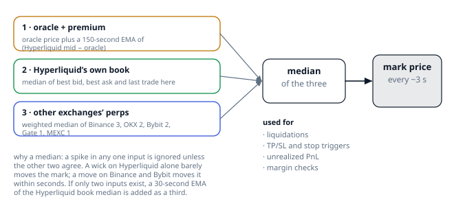

> **Try it on the site: Three inputs, one mark.** Spike the Hyperliquid input on its own and the mark hardly moves. Move the other-exchanges input and it follows. [Open the sandbox](https://abilashsenth.github.io/Hyperliquid-Bootcamp/#layer-3/mark).

**Takeaway.** Mark = median of (oracle plus smoothed premium, Hyperliquid’s book, other exchanges’ perps). One input alone cannot move it.

<details><summary><b>Quick check.</b> Hyperliquid’s own book wicks 2% down for a few seconds while Binance and Bybit do not move. What happens to the mark?</summary>

- a) It drops 2%, because the book is the mark
- b) It barely moves: one input out of three changed, and the median ignores it
- c) It drops 1%, the average of the inputs

**Answer: b.** Mark is the median of three estimates, and only the Hyperliquid-book estimate moved. The other two agree with each other, so the mark stays with them.

</details>

#### 4. Why your stop can fire at a price that never traded here

Put the last two sections together. Your stop loss triggers on the mark. The mark is two-thirds other exchanges. So when bitcoin dumps on Binance at three in the morning, the Hyperliquid book may still be sitting quietly while the mark slides through your trigger, and your stop fires at a price nobody here has traded. Then it sends a market order into that quiet book, which is why market stops are given a 10% slippage allowance.

The same mechanism protects you the other way around. If someone tries to run the Hyperliquid book down through a cluster of stops, the mark does not follow them, and the stops do not fire. The design assumes that the outside world is harder to manipulate than one book, which for BTC and ETH is true.


_The mark line reaches the trigger before the Hyperliquid tape does. The stop fires anyway._

**Takeaway.** Triggers and liquidations happen on the mark, which follows other exchanges within seconds. Watch the mark, not the tape.

#### 5. Funding: the hourly nudge, with its formula

Here is the mechanism from Layer 1, done properly. Every five seconds the exchange samples the **premium**: how far the perp sits above the oracle, measured not at the best bid and ask but at the **impact prices**, the average fill for a fixed notional (next section). The samples are averaged over the hour. Then the funding rate for the hour is computed on an 8-hour basis as premium + clamp(0.01% − premium, −0.05%, +0.05%), and one eighth of it is paid at the top of the hour.

Read the formula as a flat zone with slopes. If the premium is anywhere between −0.04% and +0.06%, the clamp cancels it exactly and the rate is the fixed interest rate, 0.01% per 8 hours, which is 0.00125% an hour: longs pay shorts a token amount. Beyond that zone, funding tracks the premium almost one for one, minus the 0.05% allowance. The rate is capped at 4% an hour, which sounds abstract until the sandbox shows you what 4% an hour does to a position.

A positive rate means longs pay shorts; negative means shorts pay longs. The payment is size × oracle price × rate, on the **oracle** notional, not the mark, and it goes peer to peer. Hyperliquid takes nothing.

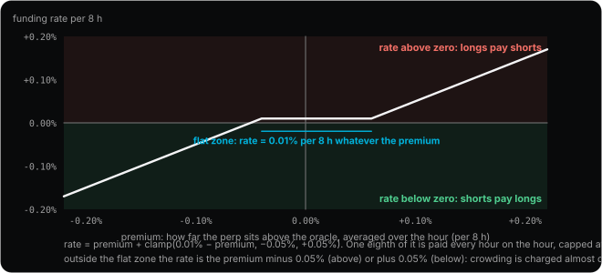

> **Try it on the site: From premium to dollars per day.** Slide the premium. Inside the flat zone the rate does not move; outside it, it tracks the premium. Then read the dollars-per-day line. [Open the sandbox](https://abilashsenth.github.io/Hyperliquid-Bootcamp/#layer-3/funding-formula).

**Takeaway.** Rate per 8 h = premium + clamp(0.01% − premium, ±0.05%), paid one eighth every hour on oracle notional. Positive: longs pay.

#### 6. What funding costs in money

Rates in hundredths of a percent hide the cost. Translate every rate into dollars per day on your notional and the picture changes. At the neutral rate, 0.00125% an hour, a 1,000-dollar long pays 30 cents a day, about 11% a year: cheap, but not free, and it is why a long held for a month with no move loses money. At a crowded 0.01% an hour, the same position pays 2.40 dollars a day, 88% a year, which is more than most trades make. At the 4% cap it pays 40 dollars an hour, and the position is gone in a day.

Two habits follow. Before any trade you plan to hold overnight, look at the funding rate in the header and the funding history tab, and write down the daily cost in dollars. And when funding is extreme, ask who is paying whom and why; a crowded side paying 1% a day is a crowd that will eventually have to leave, and Layer 6 reads that as a signal.

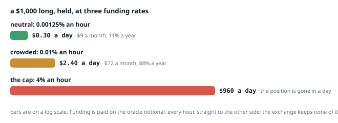

_The same 1,000-dollar long at three rates. The [funding calculator](https://abilashsenth.github.io/Hyperliquid-Bootcamp/#tools) on the Tools page does this for any notional and rate._

**Takeaway.** Turn every rate into dollars per day on your notional. Neutral is cheap, crowded is expensive, the cap is lethal.

<details><summary><b>Quick check.</b> Funding is +0.01% an hour and you are long $5,000. Roughly what do you pay per day?</summary>

- a) $0.50
- b) $12
- c) $120

**Answer: b.** 0.01% of $5,000 is $0.50 an hour, which is $12 a day, and you pay it because positive funding means longs pay.

</details>

#### 7. Impact price: what 20,000 USDC would actually get

Why measure the premium at an impact price instead of the best bid and ask? Because the best bid and ask are cheap to fake: a tiny order at the touch could tilt a whole hour of funding. Instead the exchange asks what it would cost to fill a fixed notional, 20,000 USDC for BTC and ETH and 6,000 USDC for everything else, on each side, and uses those average prices. Moving that number takes real size resting on the book.

This is the same walk through the book you did in Layer 0, used as a measuring stick. For normal perps the premium is how far the impact bid sits above the oracle, if it does, or how far the impact ask sits below it, if it does; when the oracle sits between the two impact prices, the premium is zero. For HIP-3 markets (perps deployed by outside builders, Layer 8) the premium is simply the midpoint of the two impact prices against the oracle.

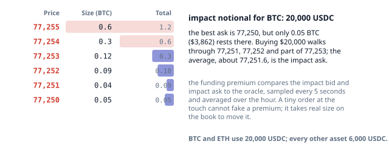

_The first 20,000 USDC of asks shaded; their average is the impact ask. Funding looks here, not at the top of the book._

**Takeaway.** The premium is measured at the average price of a fixed notional, so a tiny order at the touch cannot fake funding.

#### 8. Open interest and premium

Two numbers in the header are about crowding rather than price. **Open interest** is the total size of all positions currently open, counted once per long-short pair. It is a level, like water in a tank: it rises when new positions open and falls when they close. Volume is a flow, the size that traded in a window, and it counts opening and closing alike, so the two can tell opposite stories. Layer 6 reads open interest together with price to guess who is doing what.

The **premium**, or basis, is the perp’s price minus the oracle; funding measures it precisely at the impact prices from the previous section, and the header’s mark minus oracle is a quick read of the same thing. A premium that stays positive for hours means longs are crowded and paying to stay; the funding rate is the premium turned into a price. When you see a large positive funding rate and rising open interest together, you are looking at a crowd building on one side, and crowds pay to leave.

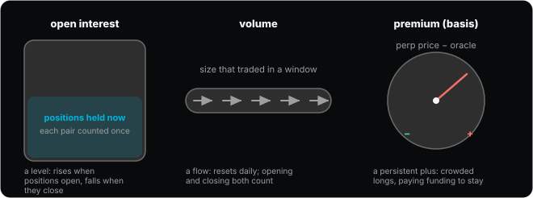

_Open interest is a level; volume is a flow; premium is a gauge of which side is crowded._

**Takeaway.** Open interest counts positions held; volume counts trades done; premium says which side is paying to stay.

#### 9. Hyperps: a different animal

Some markets on Hyperliquid list before the coin exists anywhere else: pre-launch perps, which Hyperliquid calls **hyperps**. There is no spot market to build an oracle from, so the oracle is replaced by an 8-hour exponential moving average of the hyperp’s own mark price, sampled every minute. Funding then pushes against the asset’s own momentum: after a sharp move, the next eight hours of funding heavily reward the other side.

Caps keep it from running away: the mark cannot exceed three times the 8-hour EMA, and the oracle cannot exceed four times the month’s average mark. When the coin lists on Binance, OKX or Bybit spot, the hyperp converts to a normal perp. They are a different animal, and this curriculum leaves them until Layer 7’s journal shows two blocks of twenty trades on the ordinary markets that were both profitable and traded to plan.

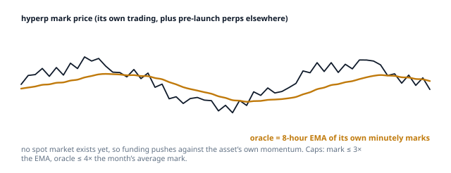

_A hyperp’s jagged mark with its own smoothed average underneath acting as the oracle._

**Takeaway.** Hyperps have no outside oracle; their own 8-hour average plays the part. Leave them for later.

#### 10. Reading the asset header

You can now read every field in the strip at the top of the trade page. Mark and oracle: if mark is above oracle, the premium is positive and longs are paying. 24-hour change and volume: thin volume means wide spreads and more slippage. Open interest: how many positions are open, to be read with price. Funding: the hourly rate now, with its sign, and a countdown to the next payment at the top of the hour.

The drills ask you to log 24 hours of funding for two coins, find a moment when mark and last diverge and name which input moved, and hold a 1x long across a funding print. After that, the header is a sentence you can read at a glance.

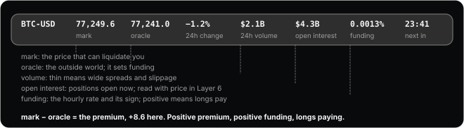

_The header strip, labelled. Mark minus oracle is a quick read of the premium (funding measures it at the impact prices); its sign is the sign of funding._

**Takeaway.** Mark above oracle means longs pay. Thin volume means slippage. The countdown says when the next payment lands.

### Recap: the ideas in one line each

- Oracle price: every validator publishes, about every 3 seconds, a weighted median of spot prices on Binance (weight 3), OKX (2), Bybit (2), Kraken, KuCoin, Gate, MEXC and Hyperliquid (1 each). Used for funding and as one input to mark.
- Mark price: the median of three inputs. The oracle plus a 150-second average of Hyperliquid’s own premium; the median of best bid, best ask and last trade here; and a weighted median of the large centralised exchanges’ (CEX) perp prices. Mark drives liquidations, TP/SL triggers and unrealized PnL.
- Mid and last: what the book shows. They can sit a few ticks from mark for minutes at a time.
- Funding: paid every hour on the hour as one eighth of an 8-hour rate. Rate = premium + clamp(0.01% − premium, −0.05%, +0.05%). The premium is sampled every 5 seconds and averaged over the hour, measured on impact prices (what 20,000 USDC of BTC or ETH, or 6,000 USDC of anything else, would move the book). Positive means longs pay shorts. Capped at 4% an hour. Paid on oracle notional, peer to peer, no fee taken. When the book sits at the oracle the rate is 0.00125% an hour, about 11% a year paid by longs.
- Open interest: total size held, counted once for both sides. It is the how-many-people-are-positioned counter; Layer 6 reads it together with price.
- Premium, or basis: perp price minus oracle. A persistent premium means crowded longs and expensive carry.
- Hyperps: pre-launch perps with no external oracle; mark is an 8-hour average of their own prints. A different animal. Leave them until you have a positive 20-trade block.

### Read: official docs

- [Robust price indices (mark price)](https://hyperliquid.gitbook.io/hyperliquid-docs/trading/robust-price-indices)
- [Oracle](https://hyperliquid.gitbook.io/hyperliquid-docs/hypercore/oracle)
- [Funding](https://hyperliquid.gitbook.io/hyperliquid-docs/trading/funding)
- [Contract specifications](https://hyperliquid.gitbook.io/hyperliquid-docs/trading/contract-specifications)
- [Hyperps](https://hyperliquid.gitbook.io/hyperliquid-docs/trading/hyperps)

### Media for this layer

- **tool** · [Funding rates across exchanges](https://www.coinglass.com/FundingRate) · Coinglass
  The same coin on Hyperliquid, Binance, Bybit and OKX side by side. The comparison is the intuition for Layer 3.
  _opened 3 Nov 2026_ · _Basic view is free; Pro and API upsells exist_
- **tool** · [HyperScreener (the official stats destination)](https://hyperscreener.asxn.xyz/home) · ASXN, free
  stats.hyperliquid.xyz now redirects here. Volume, open interest, funding and HLP figures for the whole venue.
  _opened 3 Nov 2026_ · _Run by a validator and research firm; data, not opinion_

### Do

- [ ] For BTC and one alt, write down the hourly funding for 24 hours from the funding history tab. Compute what a $1,000 long would have paid (the funding tool on the Tools page does the arithmetic).
- [ ] Find a moment where mark and last differ by more than a tick and name which input moved.
- [ ] Hold a 1x long on testnet across a funding print and watch the payment land at :00 UTC.

**Passed when:** You can state what a position pays per day at today’s rate, and which price would trigger your stop.

### Check yourself

1. Hyperliquid pays funding every:
   - a) Hour
   - b) Day
   - c) 8 hours
2. Positive funding means:
   - a) Shorts pay longs
   - b) Longs pay shorts
   - c) The exchange pays both
3. The funding payment is computed on:
   - a) Entry notional
   - b) Mark notional
   - c) Oracle notional
4. Mark price is:
   - a) The median of three inputs including other exchanges’ prices
   - b) The best bid
   - c) The last trade
5. The fixed interest component of funding, per 8 hours:
   - a) 1%
   - b) 0.01%
   - c) 0.1%

## Layer 4 · Margin, liquidation and sizing (the React of the stack)

**Goal.** Never be surprised by a liquidation, and size every trade from risk rather than from leverage.

> Leverage does not change how much you make on a move. It changes how far away the cliff is.

### The lesson

This is the layer that keeps you solvent. Everything in it follows from two numbers, your margin and the mark price, and one rule: when your equity in a position falls to a floor the asset sets, the exchange closes it for you. The second half of the layer turns that into the only sizing method this course allows: choose the stop first, size from risk, and let leverage fall out at the end.

_In the pictures, blue is you or your margin, red is the liquidation side, amber is a threshold or a reference._

#### 1. Margin is a deposit, not a price of admission

When you open a position you do not pay for it; you post a deposit against it. The **initial margin** is notional ÷ leverage: 7,725 dollars of BTC at 5x needs 1,545 dollars posted. Your equity in the position is that deposit plus or minus the unrealized PnL, measured at the mark price, and it moves every three seconds.

The floor is the **maintenance margin**, and it is set by the asset, not by you: half of the initial margin at the asset’s maximum leverage. BTC allows 40x, so its maintenance margin is 1.25% of notional. ETH at 25x is 2%; SOL at 20x is 2.5%; HYPE and most alts at 10x are 5%; a 3x coin is 16.7%. When your equity falls to that floor, liquidation starts.

So the buffer between “opened” and “liquidated” is the gap between your initial margin and that floor. At 5x on BTC it is 20% minus 1.25% of the notional. At 40x it is zero: you open on the floor.

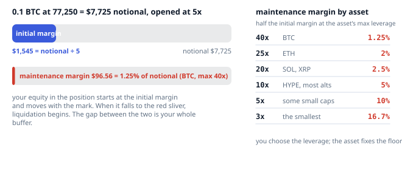

_The initial margin you post, the maintenance margin the asset requires, and the table of floors by maximum leverage._

**Takeaway.** Initial margin = notional ÷ your leverage. Maintenance margin = half the initial margin at the asset’s max leverage. The gap is your buffer.

#### 2. The cliff: leverage changes the distance, not the profit

Layer 1 showed that a 1% move is worth the same dollars at any leverage. Here is what leverage does change. On an isolated BTC long, the liquidation price is roughly (1 ÷ leverage − 1.25%) ÷ (1 − 1.25%) below the entry: about 19% at 5x, 9% at 10x, 3.8% at 20x, and nothing at all at 40x. Leverage moves the cliff closer. It does not change the slope of the ground.

For a short the cliff is above the entry and slightly closer: (1 ÷ leverage − maintenance) ÷ (1 + maintenance). The first drill is a 10x short on a 10x alt, where the maintenance margin is 5%: it liquidates about 4.8% above the entry, while a 10x long on the same coin would liquidate about 5.3% below. Work the number out before you place the drill, then watch the exchange agree with you.

The exchange checks your leverage only when you open or add. After that, nothing stops a position from drifting toward the floor; you are expected to watch it yourself. On an isolated position you can add margin, which pushes the liquidation away; on cross you can deposit, which does the same for every position at once.

Drag the sliders: pick a leverage, then move the price. Watch the equity bar drain toward the floor and the PnL number stay honest.

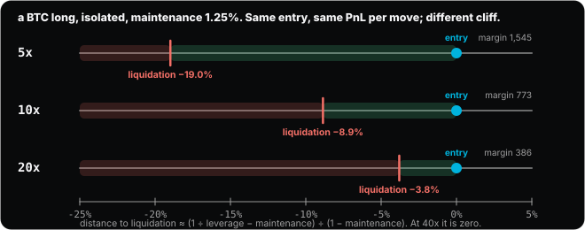

> **Try it on the site: Walk a position toward the floor.** The liquidation price is computed with the docs’ formula for an isolated position. Set the leverage, then walk the price down and see where the bar hits the floor. [Open the sandbox](https://abilashsenth.github.io/Hyperliquid-Bootcamp/#layer-4/cliff).

**Takeaway.** Liquidation distance ≈ (1/leverage − maintenance) ÷ (1 − maintenance) below the entry for a long, ÷ (1 + maintenance) above it for a short. Leverage moves the cliff; it does not change the profit on a move.

<details><summary><b>Quick check.</b> You open a BTC long at 10x, isolated. Roughly how far below your entry is the liquidation price?</summary>

- a) About 1%
- b) About 9%
- c) About 19%

**Answer: b.** (1/10 − 0.0125) ÷ (1 − 0.0125) is 8.9%. At 5x it would be 19%, at 20x 3.8%.

</details>

#### 3. Cross, isolated and strict isolated

**Cross** margin, the default, backs every cross position with your whole account: all your USDC plus the unrealized PnL of every other cross position. It is capital-efficient and it is how accounts die, because one position going badly wrong can drag every other one into a single liquidation.

**Isolated** margin gives a position its own bucket. Only the margin you assigned to it is at risk, a liquidation touches only that position, and you can add or remove margin from the bucket while it is open. **Strict isolated**, a newer mode, is the same bucket with the tap welded shut: margin can only leave as the position closes.

A detail that confuses people in cross: when you close a winning position, its margin may not appear in your available balance if another cross position is under water and needs it. The money is still yours; it is just already working.

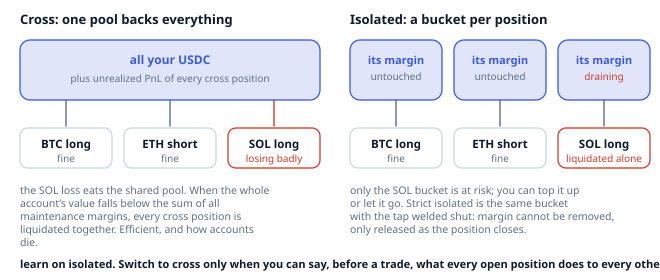

_One pool against three positions, or three buckets. In cross, a bad SOL trade can take the BTC and ETH positions with it._

**Takeaway.** Learn on isolated: one bucket per position, one liquidation at a time, and the margin you did not assign is never at risk.

#### 4. How a liquidation actually runs

Liquidation is a sequence, not a single event, and all of it runs on the mark price. First, when equity falls below the maintenance margin, the exchange sends a market order for the whole position into the book. For positions above 100,000 USDC (10,000 on testnet) it sends 20% slices with a 30-second cooldown. If enough is closed to restore the maintenance requirement, the rest of the position and whatever equity remains stay with you. There is no clearance fee: unlike some exchanges, nothing extra is charged for being liquidated.

Second, if the book cannot do the job and equity falls below two thirds of the maintenance margin, the **backstop liquidator**, a strategy inside the HLP vault, takes over the position together with its margin. In that case the maintenance margin is not returned. In cross, every cross position and the cross margin go together; in isolated, only that bucket.

Third, if even that leaves the account negative, auto-deleveraging closes profitable traders on the other side against it, which the next section explains. On liquid markets at learner size you will only ever see the first step, which is the point of the first drill: let a 20-dollar testnet short get liquidated and read what came back.

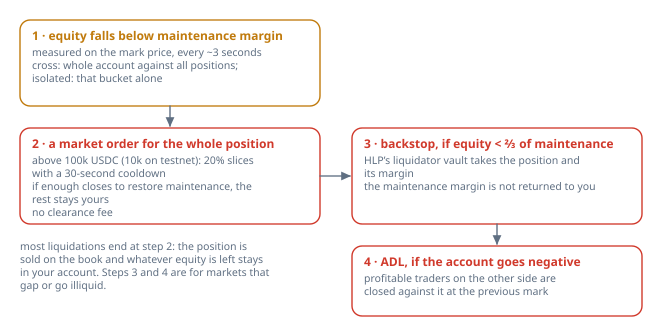

_The three stages. Almost every real liquidation ends at stage two with the leftover equity still in your account._

**Takeaway.** Below maintenance: market order. Below two thirds of maintenance: the backstop takes the position and margin. Below zero: ADL.

#### 5. ADL: you can be closed while winning

**Auto-deleveraging** is the last resort that keeps the exchange free of bad debt. When an account goes negative and the backstop cannot absorb it, the exchange looks at the traders on the opposite side of that market, ranks them by how much profit they are sitting on and how much leverage they are using (the docs’ formula multiplies mark ÷ entry by notional ÷ account value, so a big unrealised gain at high leverage ranks first), and closes the top of the list against the bankrupt position at the previous mark price.

If you are the most profitable, most levered long on the day a big short blows up, your long is closed for you, at a price you did not choose, with the profit up to that price intact. Nothing was done wrong; it is the cost of there being no clearing house. Two consequences for you: a very profitable, highly levered position is more exposed to ADL than a modest one, and a trader with no open position can never have anyone else’s losses passed to them.

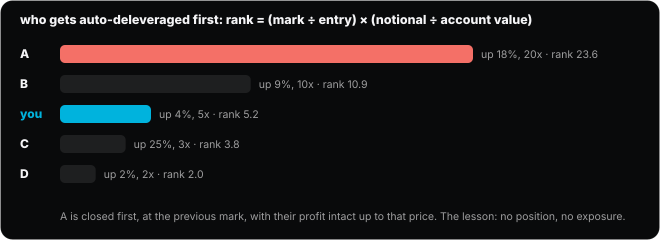

_The ADL queue: the trader with the highest profit times leverage is closed first, at the previous mark._

**Takeaway.** ADL closes the most profitable, most levered traders on the other side at the previous mark. No position means no exposure.

#### 6. Taking profit out: the 10% rule

Unrealized profit in a cross account, or in an isolated bucket, becomes usable margin at once, but moving it out is restricted. You can withdraw, transfer to spot, or pull margin from an isolated position only if what remains is at least the larger of the initial margin requirement and 10% of the total notional of your open positions. In practice: a 20x position cannot have its paper profit withdrawn until it is reduced, because 10% of notional is twice its initial margin. A worked number: a 1,000-dollar account holding 10,000 dollars of notional at 10x must keep max(1,000, 1,000) = 1,000 dollars in the account, which is all of it, so nothing comes out until the position shrinks.

This is also why the docs call entry price and PnL front-end conveniences. The thing the exchange actually tracks is margin against mark, and this rule is one of the places you feel it.

**Takeaway.** Profit comes out only while remaining margin is at least max(initial margin, 10% of open notional).

#### 7. Size from risk, not from leverage

Everything above is defensive. Here is the method that makes it almost never matter. Before a trade, choose the **stop**: the price at which the idea is wrong (Layer 6 is about finding it). Decide the **risk**: the dollars you are willing to lose if the stop is hit, 0.5% to 1% of the account in this course. Then the size is forced: notional = risk ÷ stop distance. A 1,000-dollar account risking 1% with a stop 2% away trades 500 dollars of notional, whatever the coin and whatever the leverage.

Only now does leverage enter, and only as a choice of how much margin to post against that fixed notional. Pick a leverage that keeps the liquidation price at least three stop-distances away, so that the stop, not the exchange, is what closes a losing trade. The sizer below does the arithmetic and draws the ruler; the [Tools page](https://abilashsenth.github.io/Hyperliquid-Bootcamp/#tools) has the same calculator without the drawing.

> **Try it on the site: Size from the stop, then choose a leverage.** Change the stop distance and watch the notional change. Change the leverage and watch only the margin and the liquidation move. The verdict turns red when the liquidation is closer than three stops. [Open the sandbox](https://abilashsenth.github.io/Hyperliquid-Bootcamp/#layer-4/size-from-risk).

**Takeaway.** Stop first. Risk = 0.5% to 1% of the account. Notional = risk ÷ stop distance. Leverage is an output, and it must keep the liquidation three stops away.

<details><summary><b>Quick check.</b> Account $2,000, risk 0.5%, stop 4% away. What notional do you trade?</summary>

- a) $250
- b) $500
- c) $1,000

**Answer: a.** Risk is $10. $10 ÷ 4% = $250 of notional. Leverage has not entered the calculation yet.

</details>

#### 8. A worked trade, on the ruler

Account 1,000 dollars. Risk 1%, so 10 dollars. BTC at 77,250; the stop sits 2% below at 75,705. Notional = 10 ÷ 0.02 = 500 dollars, which is 0.00647 BTC. At 5x isolated that is 100 dollars of margin. The liquidation price is about 19% below the entry, at roughly 62,600, which is nine and a half stop-distances away. If the stop is hit you lose 10 dollars and 400 dollars of margin come home untouched. If BTC fell 19% without your stop firing, something else has gone very wrong.

Now the same idea sized the way most beginners do it, from the slider: 100 dollars of margin at 20x is 2,000 dollars of notional. The same 2% stop now costs 40 dollars, four times the plan, and the liquidation sits 3.8% away, less than two stops. One stop distance of noise and the exchange closes the trade before the idea had a chance.

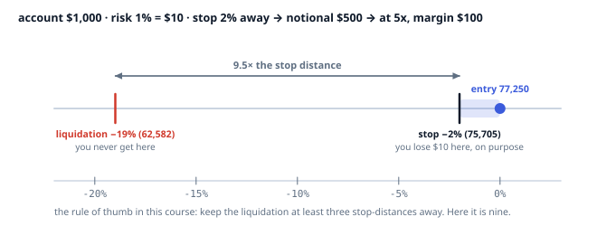

_Entry, stop and liquidation on one ruler for the worked trade. The stop is where you lose on purpose; the liquidation is where you never go._

**Takeaway.** Same account, same idea: sized from risk it costs $10 and has nine and a half stops of room; sized from the slider it costs $40 and has less than two.

#### 9. Margin tiers for big positions

One more thing you will see in the header: the maximum leverage for some assets falls as a position gets very large. BTC allows 40x up to 150 million dollars of notional and 20x above it; ETH 25x then 15x above 100 million; SOL 20x then 10x above 70 million; most alts 10x then 5x above 20 million. The maintenance margin steps up with it, in a way the docs define so that the total is continuous.

At learner size this never applies. It is here so that a lower-than-expected max leverage on a whale’s position, or on testnet, where the tiers are deliberately tiny, does not confuse you.

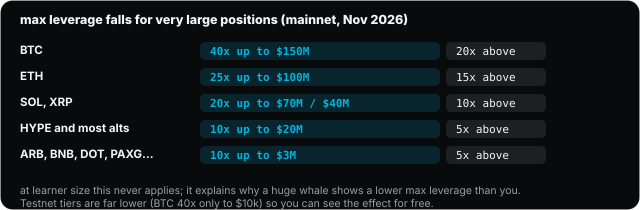

_Mainnet margin tiers in November 2026. Testnet tiers kick in at a few thousand dollars so you can watch the effect._

**Takeaway.** Very large positions get lower max leverage and higher maintenance margin. Irrelevant at your size; visible on testnet.

#### 10. The JELLY case: liquidation as a weapon

In March 2025 a trader used the liquidation machine itself as the attack. They opened a large short on JELLY, a thin coin, with deliberately thin margin, and longs in other accounts, then pushed the coin’s price up on the small spot market. The short was liquidated, the book could not absorb it, and the backstop, which is HLP, inherited a short of around four million dollars that lost more with every tick higher. The validators delisted the market and settled every position at a single price, unwinding the attack and starting an argument about who should be able to do that.

For you the case is a map of Layer 4 with real names: the floor, the market order that failed, the backstop that took over, and the vault whose depositors were on the hook. It is also why the course keeps you on validator-run, deep markets, and leaves thin coins and HIP-3 markets until Layer 7’s journal shows two blocks of twenty trades that were both profitable and traded to plan. Arkham’s forensic write-up is linked in the media list below.

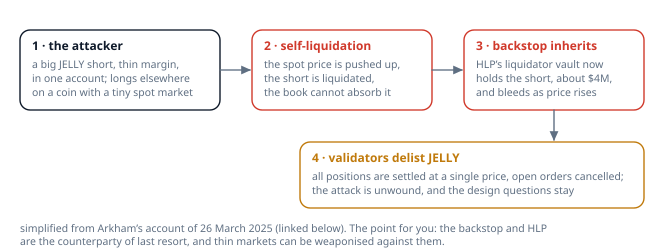

_The JELLY incident, simplified. The backstop is the counterparty of last resort, and a thin market can be aimed at it._

**Takeaway.** The backstop can be targeted. Trade deep markets until your plan has a track record, and know that HLP is who takes over when a book fails.

### Recap: the ideas in one line each

- Initial margin = notional / leverage. Maintenance margin = half the initial margin at the asset’s maximum leverage: 1.25% of notional on a 40x asset like BTC, 2% on 25x, 2.5% on 20x, 5% on 10x, up to 16.7% on 3x.
- Cross: all your USDC backs all cross positions, so one bad position can take the account. Isolated: only the margin you assigned, and a liquidation touches only that position. Learn on isolated.
- Liquidation price, isolated: liq = entry − side × margin_available ÷ size ÷ (1 − side × maintenance rate), where margin_available = margin posted − maintenance margin, side is +1 for a long and −1 for a short, and the maintenance rate is 1.25% on BTC. As a distance from the entry: (1 ÷ leverage − maintenance) ÷ (1 − maintenance) for a long and ÷ (1 + maintenance) for a short. A 5x BTC long liquidates about 19% below the entry, a 10x long about 9%, a 10x short about 8.6% above. The Tools page runs this for you.
- How a liquidation runs, all on mark price: equity below maintenance, and the engine sends a market order for the whole position (20% slices with a 30-second cooldown above 100k USDC, 10k on testnet). If equity falls below two thirds of maintenance, the backstop liquidator, a part of HLP, takes the position and its margin, and the maintenance margin is not returned. No clearance fee.
- ADL: if the backstop cannot absorb a position, the most profitable and most levered positions on the other side are closed against it at mark. You can be closed while winning. No position means no exposure.
- Unrealized profit is withdrawable only while remaining margin is at least the larger of initial margin and 10% of notional.
- Sizing: choose the stop first. Risk per trade = 0.5% to 1% of the account. Size = risk / distance to stop. Leverage is an output, not an input. Keep liquidation at least three times further away than the stop.

### Read: official docs

- [Margining](https://hyperliquid.gitbook.io/hyperliquid-docs/trading/margining)
- [Margin tiers](https://hyperliquid.gitbook.io/hyperliquid-docs/trading/margin-tiers)
- [Liquidations](https://hyperliquid.gitbook.io/hyperliquid-docs/trading/liquidations)
- [Auto-deleveraging](https://hyperliquid.gitbook.io/hyperliquid-docs/trading/auto-deleveraging)
- [FAQ: Why was I liquidated?](https://hyperliquid.gitbook.io/hyperliquid-docs/support/faq/trade-outcome-looks-incorrect/why-was-i-liquidated)
- [FAQ: How does margining work?](https://hyperliquid.gitbook.io/hyperliquid-docs/support/faq/trade-outcome-looks-incorrect/how-does-margining-work)

### Media for this layer

- **case** · [JELLYJELLY exploit on Hyperliquid](https://info.arkm.com/research/jellyjelly-exploit-on-hyperliquid) · Arkham Research, 26 Mar 2025
  The forensic account of a self-liquidation attack: three accounts, a $4.1M short pushed onto HLP, and a delisting that settled everything at one price. The case study for how backstop liquidations and HLP exposure actually work.
  _opened 3 Nov 2026_ · _Ends with a sign-up call to action; the research itself is the primary source_

### Do

- [ ] Isolated, $20 margin, 10x short on a volatile alt, on testnet. Compute the liquidation price first. Let it happen. Compare the fill, what margin came back, and how long it took.
- [ ] Rebuild the same idea as a sized trade: 1% risk, stop 2% away. Note how different the position looks.
- [ ] Switch a position from cross to isolated and back. Note what the UI does to margin each way.

**Passed when:** You state liquidation price, dollars at risk and stop distance for every trade before you send it.

### Check yourself

1. Maintenance margin on an asset whose maximum leverage is 40x:
   - a) 2.5%
   - b) 1.25%
   - c) 0.5%
2. In cross margin, a liquidation can:
   - a) Do nothing to margin
   - b) Only touch that position
   - c) Take all cross positions and the cross margin
3. The backstop liquidator takes over when equity falls below:
   - a) Two thirds of maintenance margin
   - b) Half of initial margin
   - c) Maintenance margin
4. Auto-deleveraging can close:
   - a) Only losing positions
   - b) Profitable positions on the other side
   - c) Only HLP’s positions
5. Risk $10 with a stop 2% away. Notional:
   - a) $1,000
   - b) $200
   - c) $500

## Layer 5 · Time, sessions and timezones

**Goal.** Know what hour it is in the market, what happens at :00, and which scheduled events can move your position.

> Crypto trades 24/7 but is moved by things on clocks. Hourly funding, the 00:00 UTC daily close, the US cash open, the CME weekend, Friday 08:00 UTC options expiry and 08:30 ET data releases give most days their shape.

### The lesson

Crypto trades every hour of every day, which tempts people to think time does not matter. It matters more, not less, because so much of what moves the market runs on clocks that have nothing to do with crypto: funding at the top of every hour, a daily close at midnight UTC, the US stock market’s open and close, a futures exchange that shuts for the weekend, and a few government statistics with release times printed months in advance. This layer puts all of them on one clock, yours.

_In the pictures, white is UTC, blue is IST (your clock), amber is New York, the oracle or the underlying._

#### 1. The exchange runs on UTC; you live in IST

Hyperliquid’s clock is UTC. Funding settles at the top of each UTC hour; the fee tier recomputes at the end of each UTC day; the daily candle closes at 00:00 UTC. India Standard Time is UTC+5:30 all year, which makes the conversion easy and slightly odd: everything that happens on the hour in UTC happens at half past in IST.

The trap is the United States, which moves its clocks twice a year (in 2026, daylight time ran from 8 March to 1 November). London moves too. So every US-anchored event, the stock market open, the data releases, the Fed, shifts by an hour in IST twice a year, while the UTC-anchored events stay put. Tokyo and India never move.

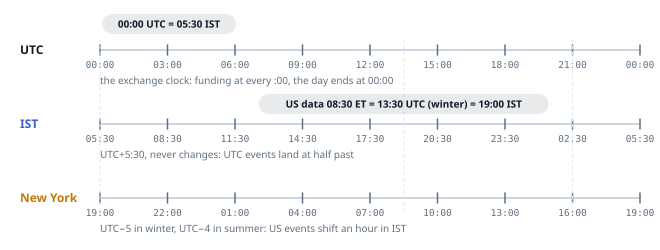

_The same day on three rulers. UTC and IST never change their offset; New York slides by an hour in March and November._

**Takeaway.** UTC events are at :30 in IST, all year. US events are at a different IST time in summer and winter.

#### 2. The hourly heartbeat: funding at :00 UTC

Every hour, on the hour UTC, which is every half hour on your clock, whoever holds a position at that second pays or receives funding. The payment is small per hour and relentless over days, as Layer 3 showed. Two practical habits: look at the countdown in the header before opening a trade you intend to hold for minutes, because opening thirty seconds before the print means paying a full hour’s funding for thirty seconds of exposure; and expect a small flurry of orders in the minute around each print as people dodge or chase the payment.

Layer 3’s last drill had you hold a 1x long on testnet across one print and watch the payment land in the funding history tab. If you skipped it, do it now; once you have seen it, you will never forget what the countdown is for.

**Takeaway.** Funding is paid at the top of every UTC hour, :30 in IST. Check the countdown before any short hold.

#### 3. 00:00 UTC: the day’s most watched minute

The daily candle closes at 00:00 UTC, 05:30 IST, and because so many traders and systems use the daily chart, where that candle closes matters more than any other price of the day. Levels drawn from daily closes are the ones Layer 6 trusts most. Binance and Bybit, the largest perp venues, pay their funding at 00:00, 08:00 and 16:00 UTC, so flows around those prints spill into every venue including this one. And Hyperliquid recomputes your fee tier at the same moment.

In IST that is early morning, which is one reason the course sits one 00:00 UTC close in the drills: you need to have watched the book at 05:30 once to believe how quiet, or how violent, it can be.

**Takeaway.** 00:00 UTC (05:30 IST) is the daily close, the big venues’ funding, and the fee-tier recompute. It is the level the market remembers.

#### 4. Sessions as regimes

The day has a shape. **Asia**, roughly 00:00 to 08:00 UTC, is usually the quietest: thinner books, smaller ranges, the occasional sharp move on no volume. **Europe**, 07:00 to 16:00 UTC, builds. The **US cash session**, from the New York open (14:30 UTC in winter, 13:30 in summer) to the close six and a half hours later, carries the most volume and almost all the macro-driven moves; the overlap of Europe and the US, roughly 19:00 to 22:00 IST depending on the season, is the loudest stretch of the day. After the New York close, volume fades into the next Asia session. Weekends are thin all the way through: bigger wicks on less size.

The research in the media list puts numbers on it: US cash hours are under 30% of the day but carried roughly 36% to 43% of bitcoin spot volume, and about 40% even on weekends. The practical reading: your stop needs more room at 03:00 IST than at 20:00 IST, and a breakout at lunchtime in Asia means less than the same breakout at the US open.

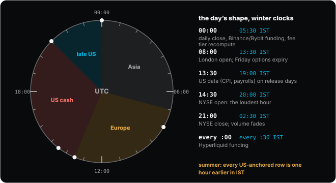

> **Try it on the site: Any hour, on both clocks.** Drag the hand to any time of day and read the session, the next funding, and what is scheduled. The ring is drawn in UTC with your IST time beside it. [Open the sandbox](https://abilashsenth.github.io/Hyperliquid-Bootcamp/#layer-5/sessions).

**Takeaway.** Asia quiet, Europe builds, the US cash session carries the day. Weekends are thin. Give stops more room when the book is thin.

#### 5. Daylight saving: the twice-a-year trap

Here is the shift in one example. The New York Stock Exchange opens at 09:30 Eastern. In winter that is 14:30 UTC and 20:00 IST. In summer, when New York is on daylight time, it is 13:30 UTC and 19:00 IST. Every US-anchored row in this layer’s calendar moves the same way: data releases from 19:00 to 18:00 IST, the Fed’s statement from 00:30 to 23:30, the CME breaks and weekly close by an hour.

Hyperliquid’s own events do not move, because they are on UTC. The market clock on this site does the conversion live and tells you which US regime is in force; the calendar table below the lesson lists both columns.

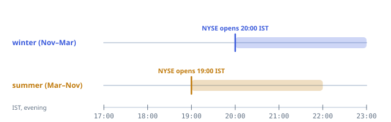

_The same NYSE open on your clock, in winter and in summer._

**Takeaway.** US events are one hour earlier in IST from March to November. Hyperliquid’s UTC events never move.

<details><summary><b>Quick check.</b> It is July. US CPI is released at 08:30 Eastern. What time is that in IST?</summary>

- a) 19:00
- b) 18:00
- c) 17:30

**Answer: b.** In summer New York is UTC−4, so 08:30 ET is 12:30 UTC, which is 18:00 IST. In winter it would be 19:00.

</details>

#### 6. The week: CME and the weekend gap

The Chicago Mercantile Exchange trades bitcoin and equity-index futures almost around the clock on weekdays, but it closes from Friday 16:00 Central to Sunday 17:00 Central, with a daily break from 16:00 to 17:00 Central. Bitcoin itself keeps trading through the weekend on Hyperliquid and everywhere else, so when CME reopens on Sunday evening its first price is often away from Friday’s last: the **CME gap**, which a large number of traders watch and which the market has a habit of revisiting.

For your purposes the weekend matters more than the gap. From Friday evening to Sunday evening the people who move size are mostly away, books are thin, and a modest order can print a long wick. The plan in Layer 7 is flat before the weekend unless the weekend is the trade.

One more weekly clock, because a calendar row and a drill depend on it. Deribit, the largest crypto options venue, settles its options every Friday at 08:00 UTC (13:30 IST), with the big monthly batch on the last Friday of the month. Into an expiry the price often sits near a level where a lot of options are struck, which traders call pinning, and it tends to move more freely once the expiry has passed. You do not need to trade options to feel it; you only need to know why Friday mornings can go quiet and then suddenly not.

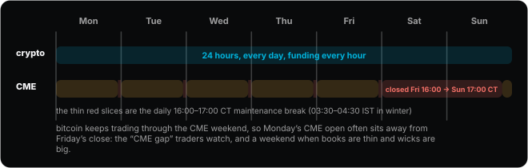

_The week on two rows: crypto never stops; CME is closed from Friday afternoon to Sunday evening Chicago time, with a daily hour-long break._

**Takeaway.** CME closes Friday 16:00 CT and reopens Sunday 17:00 CT; Deribit options expire Fridays at 08:00 UTC. Weekend books are thin, and Monday often has a gap to fill.

#### 7. Scheduled releases: CPI, payrolls, the Fed

Three US releases move crypto reliably. Consumer price inflation (CPI) and the jobs report (nonfarm payrolls) come out at 08:30 Eastern on dates the Bureau of Labor Statistics publishes a year ahead; payrolls is usually the first Friday of the month. The Federal Reserve’s rate decision comes at 14:00 Eastern on the second day of each meeting, with a press conference thirty minutes later. The next of each is on the [market clock](https://abilashsenth.github.io/Hyperliquid-Bootcamp/#clock), loaded from the official schedules through December 2027.

What they do to the tape is the same every time: a quiet hour, then a first minute that moves more than the hour before it did, then a slow settling as the market works out what it thinks. Hyperliquid’s mark price follows the big venues within seconds, so stops near the price get hit in that first minute whether or not the move lasts. The plan’s rule is blunt: no new trade within 15 minutes of a release unless the release itself is the trade, and nothing with a tight stop open across it.

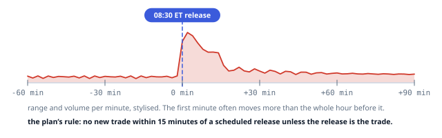

_A release minute by minute. The spike is the first minute; the plan keeps you out of it._

**Takeaway.** CPI and payrolls at 08:30 ET, the Fed at 14:00 ET. The market clock has the dates. Nothing new within 15 minutes of them.

#### 8. HIP-3 markets and the underlying’s open

Hyperliquid also lists perps on stocks, indices and commodities, deployed by builders rather than validators (Layer 8). They trade 24/7, but their underlying does not, and that creates a specific time trap. While the stock market is closed, the deployer’s oracle has nothing fresh to look at: it holds or drifts, while the perp keeps trading on weekend news, a premium builds, and funding grows with it. When the underlying opens, the oracle and the perp snap to the real print, sometimes a long way from where the perp spent the weekend.

That is a feature if the open is your trade and a trap if you simply forgot. Do not hold a HIP-3 stock or index perp through its underlying’s open by accident.

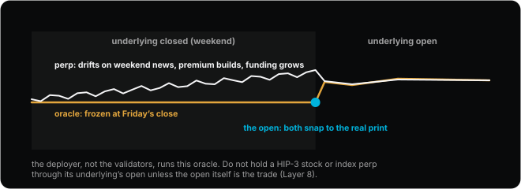

_A HIP-3 stock perp across a weekend: a frozen oracle, a drifting perp, and the snap at the open._

**Takeaway.** A HIP-3 perp trades while its underlying sleeps. The oracle freezes, the premium builds, and both snap at the open.

#### 9. Network upgrades

The last clock is the chain’s own. Hyperliquid upgrades are announced in advance on the official X account and Discord. During the short upgrade window only Post Only orders are accepted and nothing matches, and TWAPs pause. Plan no exits through an announced upgrade, and if you are holding, know that a market stop that triggers inside the window will wait until it closes.

Put every recurring event in this layer into your own calendar in IST, with the month’s CPI, payrolls and Fed dates from the market clock. That is the first drill, and it is the one that quietly pays for the rest of the course.

**Takeaway.** Upgrades are announced on X and Discord; during the window nothing matches. Put all of this in your calendar, in IST.

### Recap: the ideas in one line each

- Exchanges run on UTC. IST is UTC+5:30 all year. US clocks move twice a year (in 2026 daylight time ran from 8 March to 1 November), so every US-anchored event shifts by an hour in IST while funding and UTC levels stay put. London moves too. Tokyo and India never move.
- Funding settles every hour at :00 UTC, which is :30 past the hour in IST. Whoever holds a position at that second pays or receives.
- Fee tier is recomputed at the end of each UTC day (05:30 IST) on rolling 14-day volume.
- The daily candle closes at 00:00 UTC (05:30 IST), the most watched level in crypto. Binance and Bybit pay funding then too, and at 08:00 and 16:00 UTC (some pairs every 4 hours); flows around those prints spill into every venue.
- Network upgrades are announced on Discord and X. During the upgrade window only Post Only orders are accepted and nothing matches; TWAP slices pause.
- Sessions as regimes: Asia (00:00 to 08:00 UTC) is usually the quietest. Europe (07:00 to 16:00 UTC) builds. The US cash session (from the 09:30 ET open, 14:30 UTC in winter and 13:30 in summer, to the 16:00 ET close) carries the most volume and the macro moves; the Europe/US overlap, roughly 19:00 to 22:00 IST depending on the season, is the loudest stretch of the day. Weekends are thin: bigger wicks on less size.
- CME is closed from Friday night to Sunday night, so bitcoin’s Monday open on CME often sits away from Friday’s close, the CME gap that traders watch.
- HIP-3 stock, index and commodity perps trade 24/7 while their underlyings are closed. The deployer’s oracle freezes or drifts with the book, premiums and funding build, and both snap at the underlying’s open. Do not hold one through an open unless that is the trade (Layer 8).

### Calendar in IST

| Event | UTC | IST, Nov to Mar | IST, Mar to Nov |
| --- | --- | --- | --- |
| Hyperliquid funding | every :00 | every :30 | every :30 |
| Daily close, Binance/Bybit funding, Tokyo open | 00:00 | 05:30 | 05:30 |
| NSE India session | 03:45 to 10:00 | 09:15 to 15:30 | 09:15 to 15:30 |
| London open | 08:00 (07:00 summer) | 13:30 | 12:30 |
| Binance/Bybit funding | 08:00, 16:00 | 13:30, 21:30 | 13:30, 21:30 |
| Deribit options expiry (Fridays; monthly on the last Friday) | 08:00 | 13:30 | 13:30 |
| US CPI and NFP (08:30 ET) | 13:30 (12:30 summer) | 19:00 | 18:00 |
| NYSE open (09:30 ET) | 14:30 (13:30 summer) | 20:00 | 19:00 |
| FOMC statement (14:00 ET), press conference 30 min later | 19:00 (18:00 summer) | 00:30 next day | 23:30 |
| NYSE close (16:00 ET) | 21:00 (20:00 summer) | 02:30 next day | 01:30 next day |
| CME daily break (16:00 to 17:00 CT) | 22:00 to 23:00 (21:00 to 22:00 summer) | 03:30 to 04:30 | 02:30 to 03:30 |
| CME weekly close, Friday (16:00 CT) | 22:00 (21:00 summer) | 03:30 Saturday | 02:30 Saturday |
| CME weekly open, Sunday (17:00 CT) | 23:00 (22:00 summer) | 04:30 Monday | 03:30 Monday |

### Read: official docs

- [Funding (the hourly cadence)](https://hyperliquid.gitbook.io/hyperliquid-docs/trading/funding)
- [Fees (the UTC day)](https://hyperliquid.gitbook.io/hyperliquid-docs/trading/fees)

### Media for this layer

- **research** · [Trading activity in bitcoin far higher during U.S. trading hours](https://k33.com/research/archive/articles/trading-activity-in-bitcoin-far-higher-during-us-trading-hours) · Vetle Lunde, K33 Research, 18 Jan 2022
  Numbers behind the session map: US cash hours are under 30% of the day but carried 36% to 43% of spot volume, and about 40% even on weekends. Old, but the shape has not changed.
  _opened 3 Nov 2026_ · _No promotion_
- **research** · [Intraday patterns in crypto: activity, volatility and spreads follow US hours](https://arxiv.org/pdf/2109.12142v2.pdf) · arXiv 2109.12142 (academic paper, 2021)
  Academic confirmation that the highest activity, highest volatility and lowest spreads on US exchanges coincide with US market hours, and that European venues follow their own local time.
  _seen in search results, not opened_ · _Seen in search results, not opened today_
- **calendar** · [NYSE hours and holidays](https://www.nyse.com/markets/hours-calendars) · NYSE
  Core session 09:30 to 16:00 ET; the holiday list is what the market clock does not model.
  _opened 3 Nov 2026_
- **calendar** · [CME Globex trading hours](https://www.cmegroup.com/trading-hours.html) · CME Group
  Equity index and bitcoin futures: Sunday 17:00 CT to Friday 16:00 CT with a daily 16:00 to 17:00 CT break. The source of the CME gap.
  _long-standing link, not re-opened_ · _Page timed out twice today; hours stated from the standard schedule_
- **calendar** · [CPI release schedule](https://www.bls.gov/schedule/news_release/cpi.htm) · US Bureau of Labor Statistics
  08:30 ET. Loaded into the market clock through Dec 2027.
  _opened 3 Nov 2026_
- **calendar** · [Employment Situation (nonfarm payrolls) schedule](https://www.bls.gov/schedule/news_release/empsit.htm) · US Bureau of Labor Statistics
  08:30 ET, usually the first Friday. Loaded into the market clock through Dec 2027.
  _opened 3 Nov 2026_
- **calendar** · [FOMC meeting calendar](https://www.federalreserve.gov/monetarypolicy/fomccalendars.htm) · Federal Reserve
  Statement at 14:00 ET on the second day, press conference 30 minutes later. The 2026 and 2027 dates are loaded into the market clock.
  _opened 3 Nov 2026_
- **calendar** · [Economic calendar](https://www.forexfactory.com/calendar) · ForexFactory
  Set the timezone to IST once and it shows every scheduled release in your clock. Ignore its forums.
  _long-standing link, not re-opened_ · _Not opened today_

### Do

- [ ] Put the calendar into your own calendar as recurring events in IST, plus this month’s CPI, NFP and FOMC dates (the Market clock page lists the next ones).
- [ ] Sit through one US open and one 00:00 UTC close on the 1-minute BTC chart with the book open. Note spread and range before, during and after.
- [ ] Hold a small testnet position across a Friday 08:00 UTC expiry and a weekend. Note Monday’s CME gap.

**Passed when:** For any IST time you can say which session you are in, when the next funding and the next scheduled release are, and whether US clocks are on daylight time.

### Check yourself

1. Hyperliquid funding settles at:
   - a) 00:00, 08:00 and 16:00 UTC
   - b) 08:00 UTC daily
   - c) :00 UTC every hour
2. IST is:
   - a) UTC+5:30
   - b) UTC+4:30
   - c) UTC+5
3. NYSE opens, in IST, during US winter time:
   - a) 19:00
   - b) 20:00
   - c) 21:00
4. The most watched daily candle close in crypto:
   - a) 00:00 ET
   - b) 09:30 ET
   - c) 00:00 UTC
5. The CME Globex daily break is:
   - a) 16:00 to 17:00 Central Time
   - b) 12:00 to 13:00 Central Time
   - c) There is none

## Layer 6 · Reading the market

**Goal.** Form a one-sentence thesis from the chart, the book, open interest and funding, and know what would prove it wrong.

> On Hyperliquid the positioning data other venues hide is public. Who is long, how levered, and where they get liquidated is on-chain, and the explorers show it.

### The lesson

Everything before this layer was mechanics: what the exchange does. This layer is judgement: forming an opinion about where price is going, in one sentence, with a level that would prove it wrong. It is deliberately modest. You are not learning to predict; you are learning to say what you think, why, and what would change your mind, and then to grade yourself every day until the habit sticks. Hyperliquid adds one unusual tool: the positions of every other trader are public.

_In the pictures, green and red are up and down moves or long and short crowds, blue is you or your level, amber is a reference level._

#### 1. Timeframes: context, structure, entry

Start with the chart, and start with the slowest one. The **daily** chart says which way the tide is running and holds the levels the market remembers, the 00:00 UTC closes. The **4-hour** chart shows the structure: the swings, the last higher low, the place where the trend would be wrong. The **1-hour** chart shows timing, when the structure is being tested. The **5- and 15-minute** charts are for pulling the trigger and nothing else.

The rule that keeps beginners out of trouble: when two timeframes disagree, the higher one wins. A perfect-looking 5-minute breakout inside a 4-hour downtrend is a 4-hour downtrend.

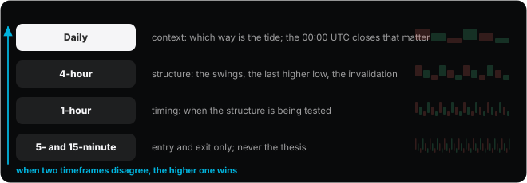

_Each timeframe has one job. The thesis lives on the daily and 4-hour; the 5-minute only times the click._

**Takeaway.** Daily for context, 4-hour for structure, 1-hour for timing, 5-minute for the click. The higher timeframe wins.

#### 2. Structure: higher highs, higher lows, and the invalidation

An uptrend is a sequence of higher highs and higher lows; a downtrend the mirror. That definition gives you the invalidation for free: an uptrend is wrong, by definition, when price closes below the most recent higher low. That level is where the stop goes, which is why Layer 4 could say “choose the stop first”: the chart chooses it for you.

**Support** and **resistance** are zones, not lines, and they are zones because of Layer 0: they are prices where the book got heavy before, where a lot of orders filled and a lot of people remember their entry. Prior daily closes are the strongest of them. Draw them as bands, not lines: on BTC a zone is tens of dollars wide, far more than the one-dollar tick, because the orders that made it were spread over a range.


_Higher highs and higher lows, with the last higher low marked. Below it the uptrend is wrong, so that is where the stop lives._

**Takeaway.** The last higher low is the invalidation of an uptrend. The stop goes just beyond it, and sizing follows from there.

<details><summary><b>Quick check.</b> An uptrend on the 4-hour chart. Where is the invalidation?</summary>

- a) Below the most recent higher low
- b) Below the most recent higher high
- c) At the 24-hour low

**Answer: a.** An uptrend is higher highs and higher lows. It stops being one when price closes below the last higher low, so that is the level that proves the thesis wrong.

</details>

#### 3. Volume confirms

A move that happens on rising volume is a move that many people agreed to; a move on thin volume is one that a few people were able to push. The practical test is simple: when price breaks a level, look at the volume bars under the break compared with the hour before it. A break on rising volume holds more often than one on thin volume, and a break during the quietest hours of the week, a Sunday in the Asia session, is suspect until it is confirmed when the big sessions wake up.

Layer 5 is the other half of this. Knowing when the book is thin tells you which breaks to distrust before the volume bar even prints.


_The same level broken twice: on rising US-session volume it holds; on thin Sunday volume it fails and falls back._

**Takeaway.** Volume is agreement. A break on rising volume in a busy session is worth more than one on a thin weekend.

#### 4. The open interest matrix

Layer 3 defined open interest as the total size of positions currently open. Read it together with price and it tells you who is doing what. Price up with open interest up: new longs are opening, a trend that is also a crowd forming. Price up with open interest down: shorts are covering, a rise powered by people leaving, which runs out when the covering ends. Price down with open interest up: new shorts. Price down with open interest down: longs closing or being liquidated, which is often how a move ends, because once the forced sellers are done there is nobody left to sell.

Funding is the third dial. If the crowd on one side is paying a lot to stay, the move is more fragile than the chart suggests. Two cautions from the research in the media list: short-side signals are weaker than long-side ones, and open interest lags intraday, so this is a daily and 4-hour tool, not a 5-minute one.


> **Try it on the site: Price, open interest, funding: who is doing what?.** Pick a price direction and an open-interest direction, then add a funding reading, and read the interpretation. Then find twenty real hours on the chart and classify them: that is the second drill. [Open the sandbox](https://abilashsenth.github.io/Hyperliquid-Bootcamp/#layer-6/oi-matrix).

**Takeaway.** Price with OI: up-up new longs, up-down covering, down-up new shorts, down-down longs leaving. Funding says how crowded the side is.

#### 5. Funding tells you who is paying to stay

The funding history tab on Hyperliquid is a list of who paid whom, hour by hour. Sustained positive funding means longs have been paying for hours or days; the position is crowded and the people in it are losing a little every hour, which makes them quick to leave. Sustained negative funding is the mirror. Extreme funding in either direction is not a signal to fade on its own, but it is a reason to distrust a move in the crowded direction and to expect a violent one the other way when the crowd is forced out.

Compare venues too: Coinglass shows the same coin’s funding on Hyperliquid, Binance, Bybit and OKX side by side. When every venue agrees, the crowd is everywhere; when Hyperliquid alone is extreme, the crowd is local and small.

**Takeaway.** Hours of one-sided funding mean a crowd that pays to stay and leaves fast. Distrust moves in the crowded direction.

#### 6. Liquidation clusters: where price gets pulled

Leveraged positions get liquidated at predictable distances from their entries, roughly 1/leverage below for longs and above for shorts, and because people choose round leverage, those levels cluster. A cluster of long liquidations below the price is a pool of forced sellers waiting to be triggered: if price reaches it, the liquidations sell into the book and push price further, which triggers the next. That is why price so often “runs the stops” and then reverses: the forced selling finishes and the buyers were waiting underneath.

Heatmaps estimate where the clusters sit from exchange data; treat them as a map of where stops are, not as a prediction. On Hyperliquid you do not have to estimate afterwards: the explorers and the trades tape show the liquidation prints as they happen, with the addresses attached.


_Estimated liquidation clusters around the price. The nearest large one below pulls price toward it, because reaching it forces selling._

**Takeaway.** Liquidations cluster at round leverage distances. Price is drawn to the nearest cluster, and often reverses once it is cleared.

#### 7. Hyperliquid’s tells: what is public here

On a centralised exchange, positioning is a rumour. On Hyperliquid it is a table. The leaderboard shows who is making and losing money, by account. The explorer shows every fill and liquidation by address. Hypurrscan and Hyperdash show the largest open positions, their entries and their liquidation prices. Coinglass shows long-short ratios and the funding paid. All of it is free and all of it updates in real time.

Use it for one thing at this stage: to see who is on the other side of a move. When price is running into a cluster and the explorer shows a handful of very large longs with liquidation prices just below it, the mechanism in the previous section is no longer a theory. The media list for this layer has every tool with a note on what it is for and what it tries to sell you.

**Takeaway.** Positions, liquidations and the leaderboard are public. Use them to see who is on the other side, not to copy anyone.

#### 8. The one-sentence thesis

Everything in this layer compresses into one sentence a day: a bias, the level that holds it, the evidence from open interest and funding, and the price that would prove it wrong. “BTC is bullish while 76,200 holds, because open interest is rising with price and funding is near neutral. Wrong below 75,900.” That is a complete thesis. Anything without the last part is content, not analysis, which is also the test the course’s [Noise filter](https://abilashsenth.github.io/Hyperliquid-Bootcamp/#noise) page applies to other people’s opinions.

The drill is ten consecutive days of these, for BTC and one alt, written before the US open and graded at 00:00 UTC. Grade the reasoning, not the outcome: a well-argued note that turned out wrong is a pass; a lucky guess with no level is a fail. The sandbox builds the sentence and copies it for your notes.


> **Try it on the site: Write today’s sentence.** Fill in the four blanks and copy the sentence. Ten of these in a row, graded, is the pass check for this layer. [Open the sandbox](https://abilashsenth.github.io/Hyperliquid-Bootcamp/#layer-6/thesis).

**Takeaway.** Bias, level, evidence, invalidation. One sentence a day, graded on the reasoning at 00:00 UTC.

### Recap: the ideas in one line each

- Timeframes: daily for context, 4-hour for structure, 1-hour for timing, 5- and 15-minute for entries. The higher timeframe wins a disagreement.
- Structure: higher highs and higher lows make an uptrend; the last higher low is the invalidation. Support and resistance are zones where the book got heavy before. Prior daily closes at 00:00 UTC matter most.
- Volume confirms: a break on rising volume holds more often than one on thin volume. Weekend breaks are suspect.
- The OI matrix. Price up with OI up: new longs, a trend that is also crowding. Price up with OI down: shorts covering, fuel running out. Price down with OI up: new shorts. Price down with OI down: longs liquidating, often the end of a move. Funding tells you who is paying to stay.
- Liquidation levels: leveraged positions cluster at round leverage and get liquidated in clusters, so price is drawn to them. Heatmaps estimate the clusters; the trades tape and explorers show the prints.
- Hyperliquid tells: the funding history tab, open interest in the asset header, the leaderboard, and the largest positions on the explorers.

### Read: official docs

- [Portfolio graphs](https://hyperliquid.gitbook.io/hyperliquid-docs/trading/portfolio-graphs)
- [Miscellaneous UI](https://hyperliquid.gitbook.io/hyperliquid-docs/trading/miscellaneous-ui)

### Media for this layer

- **research** · [Inferring leveraged positioning from price and open interest](https://research.glassnode.com/leverage-position-openings-and-closures) · Frederik Theissen, Glassnode Research, 3 Jul 2025, 8 min
  The OI matrix in Layer 6, done properly: long openings, long closures, short openings, short closures, with the caveats (short-side signals are weaker, the metric lags intraday). Free.
  _opened 3 Nov 2026_ · _No paywall; newsletter prompt only_
- **tool** · [Hyperliquid whale tracker](https://www.coinglass.com/hyperliquid) · Coinglass
  Large Hyperliquid positions, long/short ratios, unrealized PnL and funding paid, read straight from the chain.
  _opened 3 Nov 2026_ · _Login prompts and Pro tier; the public view works_
- **tool** · [Liquidation heatmap](https://www.coinglass.com/pro/futures/LiquidationHeatMap) · Coinglass
  Estimated clusters of liquidation levels. Treat it as a map of where stops sit, not a prediction.
  _opened 3 Nov 2026_ · _Pro tier for some settings_
- **tool** · [Hypurrscan](https://hypurrscan.io) · Community explorer
  Address-level positions, fills, vaults and liquidations on Hyperliquid. Free. Use it to see who is on the other side of a move.
  _opened 3 Nov 2026_ · _Labelled beta_
- **tool** · [Hyperdash](https://hyperdash.info) · Community analytics
  Positions, liquidations and funding dashboards for Hyperliquid, free.
  _seen in search results, not opened_ · _Blocked automated access today; existence confirmed by several sources_
- **tool** · [Hyperliquid leaderboard](https://app.hyperliquid.xyz/leaderboard) · Official app
  Who is making and losing money, by account, because every book is public. Humbling and useful.
  _seen in search results, not opened_
- **tool** · [Hyperliquid explorer](https://app.hyperliquid.xyz/explorer) · Official app
  Every fill and liquidation, by address and block.
  _long-standing link, not re-opened_
- **tool** · [Hyperliquid open interest](https://defillama.com/open-interest/chain/hyperliquid-l1) · DefiLlama
  Venue-level open interest over time, free and independent.
  _seen in search results, not opened_ · _Blocked automated access today_
- **tool** · [HyperTracker](https://hypertracker.io/) · Independent
  Wallet PnL, liquidation distance and cohort leaderboards. The free dashboard is useful; ignore the marketing.
  _opened 3 Nov 2026_ · _Heavy API upsell (paid plans from $179 a month)_ · _Unsourced claims on its landing page_
- **book** · The Art and Science of Technical Analysis · Adam Grimes, 2012
  The one technical-analysis book that argues from evidence. His old free course now sits behind a subscription site, so the book is the resource.

### Do

- [ ] For 10 days, before the US open, write one sentence each on BTC and one alt: bias, the level that invalidates it, and what OI and funding say. Grade it at 00:00 UTC.
- [ ] Classify 20 recent 1-hour moves into the four OI quadrants.
- [ ] Mark the three largest liquidation clusters on BTC and watch what happens when price reaches one.

**Passed when:** Ten consecutive daily notes exist, each with a thesis and an invalidation, graded.

### Check yourself

1. Price up and open interest up suggests:
   - a) New longs opening
   - b) Longs closing
   - c) Shorts covering
2. Price down and open interest down suggests:
   - a) New shorts
   - b) Longs closing or being liquidated
   - c) New longs
3. The 4-hour and 5-minute charts disagree. Which wins?
   - a) Neither
   - b) The 5-minute
   - c) The 4-hour
4. On Hyperliquid, positions and liquidations are:
   - a) Public on-chain
   - b) Visible only to market makers
   - c) Hidden
5. A breakout on thin weekend volume is:
   - a) More reliable
   - b) Less reliable
   - c) The same

## Layer 7 · Plan, journal, review, psychology (the Next.js of the stack)

**Goal.** Trade a written plan with fixed risk, journal every trade, and review in blocks of 20. This is the production app. Everything before it was components.

> The enemy is not fear or greed. It is unplanned decisions. Every rule below exists to remove one decision from the moment.

### The lesson

Everything before this layer was a component. This is the application: a written plan, a fixed amount of risk, a journal, and a review every twenty trades. It is the layer most people skip because it looks like paperwork, and it is the layer that separates the people who are still trading in a year from the people who are not. There are no new exchange mechanics here. There is one idea, repeated in six forms: take decisions out of the moment.

_In the pictures, blue is a decision made in advance or a rule, red is a decision made in the moment, green is a result._

#### 1. The enemy is unplanned decisions

Fear and greed get the blame, but they are symptoms. The disease is making decisions with money on the line: where the stop goes, whether to add, whether to take profit early, whether to try one more trade. Each of those decisions, made in the moment, is made by the worst version of you: tired, excited, anchored to the last tick.

The plan is not a prediction. It is a list of decisions moved to a calm moment, before the trade, when you can still think. Every rule in this layer exists to move exactly one decision from the heat of the moment to the plan, where it is cheap.


_The same trade with its decisions in two places. The plan empties the second row._

**Takeaway.** The plan is a list of decisions made in advance. Its job is to leave nothing to decide while the trade is open.

#### 2. The plan, one line each

A plan is seven lines. **Setup**: the pattern or condition you are trading, named so you can count it later. **Entry**: the price and order type. **Invalidation**: the price at which the idea is wrong, which Layer 6 gave you and which is where the stop goes. **Target**: where you take profit, usually a multiple of the stop distance. **Size**: from risk, as Layer 4 taught; never from leverage. **Time stop**: when you leave if nothing has happened. **Early exit**: the condition short of the stop that means the idea has already failed.

Write it before the order, not after. If any line is blank, there is no trade; that is the whole test. The card below uses the worked numbers from Layer 4.


_A filled plan. Seven lines, written before the order, with the size computed from the stop._

**Takeaway.** Setup, entry, invalidation, target, size, time stop, early exit. Blank line, no trade.

#### 3. R: the unit that makes trades comparable

Record results in **R**, not dollars. 1R is the dollars at risk on the trade, the distance from entry to stop times the size. A trade that hits its stop is −1R; one that reaches a target three stop-distances away is +3R. The unit makes trades comparable across markets, sizes and account growth: a +2R on a 1,000-dollar account and a +2R on a 100,000-dollar account are the same trade, and your statistics stay meaningful as the account changes.

It also fixes the question people argue about for years, “what win rate do I need?”. With 1R losers and 3R winners you can lose two trades in three and make money. The Journal page here computes R for every trade, net of the fees and funding you enter.


_A ruler in R. The stop is −1R by definition; targets are set in multiples of it._

**Takeaway.** 1R = the dollars at risk on the trade. Results in R are comparable across sizes, markets and time.

<details><summary><b>Quick check.</b> Your entry is 76,350, your stop 75,900 and your size 0.0222 BTC. You exit at 77,250. Result in R?</summary>

- a) +2.0R
- b) +0.9R
- c) +9R

**Answer: a.** 1R is (76,350 − 75,900) × 0.0222 = $10. The exit is 900 above entry, which is 2.0 stop distances, so +2R before fees.

</details>

#### 4. Expectancy, and why one trade says nothing

**Expectancy** is the average R you make per trade: win rate × average win − loss rate × average loss. A system that wins 45% of the time with +2R winners and −1R losers has an expectancy of 0.45 × 2 − 0.55 × 1 = +0.35R per trade, which is excellent. It also loses money in about one block of twenty out of seven, purely by chance, and has losing streaks of five or six in a row every few hundred trades.

That is why the course judges everything in blocks of 20 trades and never on a single trade. A trade is a coin flip with a slightly bent coin; a block is a sample. Run the simulation below with your own numbers and look at the spread of block results. Then look at the worst losing streak. That streak will happen to you, and the plan must survive it, which is where the 1% risk rule comes from.


> **Try it on the site: Two hundred blocks of twenty trades.** Set a win rate and the average win and loss in R, then run two hundred blocks. Notice how many blocks lose with a positive expectancy, and how long the losing streaks get. [Open the sandbox](https://abilashsenth.github.io/Hyperliquid-Bootcamp/#layer-7/expectancy).

**Takeaway.** Expectancy = win rate × average win − loss rate × average loss, in R. Judge it over blocks of 20. Plan for the losing streak.

#### 5. Hard rules

These are the rules that do not get reviewed. They are the floor under everything else.

1. At most 1% of the account at risk per trade; 0.5% for the first mainnet block.
2. Stop for the day at −3R. Close the screen.
3. A maximum number of trades per day, written down. Three is a good start.
4. No new trade within 15 minutes of a scheduled release unless the release is the plan.
5. Never add size after a loss. Never widen a stop.
6. Flat before the weekend unless the weekend is the plan.
7. Reduce-only on every exit order, and a stop on every position: attached to the entry order when the form allows it, placed by hand the moment the entry fills when it does not.

**Takeaway.** Seven hard rules that do not get reviewed. They exist so that the worst streak is survivable.

#### 6. The journal and the grade

The journal is the plan plus what happened. Date and time in IST and UTC, market, setup, direction, entry, stop, target, size, exit, fees, funding paid, the result in R, the exit reason, a screenshot before and after, and one lesson. And a **grade** for plan adherence, A, B or C, kept strictly separate from the PnL: an A on a −1R trade is a good trade, a C on a +3R trade is a lucky one. Over a block, the share of A grades, the adherence, is the number that tells you whether you are trading the plan or trading your feelings.

The [Journal page](https://abilashsenth.github.io/Hyperliquid-Bootcamp/#journal) on this site has every field, computes R net of fees and funding, and judges each block of 20 by expectancy and adherence. The first drill is to back-fill your last five testnet trades into it, to learn the fields before they matter.


_One entry, every field. The grade is for adherence, never for the result._

**Takeaway.** Journal every trade with a grade for adherence kept separate from PnL. Adherence over a block is the number that matters.

#### 7. The weekly review loop

Once a week, thirty minutes, with the journal open: the block’s expectancy and adherence so far, the best trade and the worst trade and why each went the way it did, and one rule to add or remove. One. Then nothing else changes until the next review: not the risk, not the setups, not the size. The temptation to redesign the plan after every losing day is the same unplanned decision from the first section wearing a lab coat.

Why one rule at a time: a block of 20 is a small sample, and if you change three things at once you will never know which one mattered.


_Twenty trades, one review, one change, twenty more._

**Takeaway.** Review weekly for thirty minutes. Change one rule at most. Between reviews, change nothing.

#### 8. Graduation: testnet to mainnet

The ladder is earned by blocks, not by dates. Twenty planned testnet trades, every one journaled and graded, with the expectancy and adherence read off the Journal page. Then mainnet at the minimum size, 10-dollar orders, isolated margin, 0.5% risk, for twenty more. Raise risk toward 1% only after a block that is both positive and above 90% adherence. Add HIP-3 markets or hyperps only after two such blocks on the main perps.

The pass check for the whole layer, and in a sense the whole course, is two consecutive blocks above 90% adherence, whatever the PnL says. PnL follows adherence with a lag; adherence does not follow PnL at all.


_Four steps, each earned by a block of twenty._

**Takeaway.** Testnet block, then mainnet at minimum size, then more risk after a positive block with 90% adherence. Dates earn nothing.

#### 9. Five truths and one habit

Mark Douglas, whose seminar and book are in the media list for this layer, reduced trading psychology to five truths. Anything can happen. You do not need to know what will happen next to make money. Wins and losses are randomly distributed for any set of variables that define an edge. An edge is nothing more than a higher probability of one thing happening over another. Every moment in the market is unique.

Read them against the sandbox you just ran. A positive expectancy with random ordering is exactly what the five truths describe, and the plan is how you act on them: you take every valid setup at fixed risk because any single outcome is noise and only the block is signal. The habit that follows is simple to say and takes a year to build: trade the plan, grade the adherence, and let the PnL be a by-product.

**Takeaway.** Anything can happen; the edge is only a probability; the order of wins and losses is random. So trade the plan and grade the adherence.

### Recap: the ideas in one line each

- The trade plan, one line each: setup, entry, invalidation (the stop), target, size from risk, time stop, and what would make you exit early.
- R: 1R is the dollars at risk on the trade. Record results in R (+2R, −1R), not dollars; it makes trades comparable at any account size.
- Expectancy = win rate × average win in R − loss rate × average loss in R. Judge it over blocks of 20 trades. One trade says nothing.
- Hard rules: at most 1% risk per trade; stop for the day at −3R; a maximum number of trades per day; no trade within 15 minutes of a scheduled release unless it is the plan; never add size after a loss; flat before the weekend unless planned.
- Journal fields: date and time in IST and UTC, market, setup, direction, entry, stop, target, size, R, fees, funding paid, exit reason, a grade for plan adherence (A followed, C did not) kept separate from PnL, a screenshot before and after, and one lesson. The Journal page here holds all of it and computes the block statistics.
- Review: weekly, 30 minutes, the block’s expectancy and adherence, the best and worst trade, one rule to add or remove. Nothing else changes between reviews.

### Read: official docs

- [Entry price and PnL (so your journal matches the exchange)](https://hyperliquid.gitbook.io/hyperliquid-docs/trading/entry-price-and-pnl)

### Media for this layer

- **video** · [Mark Douglas, Think like a professional trader (4-part seminar)](https://www.youtube.com/results?search_query=Mark+Douglas+Stock+Trading+Psychology+Seminar+Think+like+a+professional+trader+Part+1+of+4) · Recorded seminar, about 4 hours total, re-uploaded on YouTube by Modern WallStreet
  The lecture version of Trading in the Zone: thinking in probabilities, why fear produces trading errors, what an edge actually is. Watch one part per week during Layer 7.
  _seen in search results, not opened_ · _Link is a YouTube search for the exact title; the uploads are re-posts, so pick the one from Modern WallStreet_ · _Skip the AI summary sites that rank above it_
- **article** · [TraderFeed](https://traderfeed.blogspot.com) · Brett Steenbarger, blog, posting as of 2 Nov 2026
  Twenty years of short posts by a clinical psychologist who coaches hedge-fund and prop traders. Free. Read the archive on process and self-coaching, one post a day.
  _opened 3 Nov 2026_ · _Links to his own books; no courses, no signals_
- **podcast** · [Chat With Traders](https://chatwithtraders.com) · Podcast since 2015, 250+ episodes
  Long interviews with working traders across futures, equities and crypto. Pick episodes by guest. Skip any where the guest sells a course; the ones that remain are the best free oral history of discretionary trading.
  _opened 3 Nov 2026_ · _Sponsor reads; original host handed over in 2022_
- **book** · Trading in the Zone · Mark Douglas, 2000
  Chapters 7 to 11 are the core: probabilities, consistency, the five fundamental truths.
- **book** · The Daily Trading Coach · Brett Steenbarger, 2009
  101 short lessons for coaching yourself. One a day alongside the drills.
- **book** · Market Wizards · Jack Schwager, 1989
  Interviews with traders about process and risk. Still the best antidote to influencer trading content.

### Do

- [ ] Back-fill your last five testnet trades into the Journal page to test the fields.
- [ ] 20 planned testnet trades, every one journaled and graded. Read the expectancy and adherence the journal computes.
- [ ] Graduate: mainnet, minimum size ($10 orders), isolated margin, 0.5% risk, 20 more trades. Raise risk toward 1% only after a block that is positive and above 90% adherence.

**Passed when:** Two consecutive 20-trade blocks show above 90% plan adherence, whatever the PnL says.

### Check yourself

1. 1R equals:
   - a) 1% of the account, always
   - b) The dollars at risk on that trade
   - c) The distance to target
2. Expectancy is judged over:
   - a) A calendar year
   - b) One trade
   - c) Blocks of 20 trades
3. The adherence grade should be:
   - a) Kept separate from PnL
   - b) Skipped on winners
   - c) Tied to PnL
4. After a losing trade you:
   - a) Double the size to recover
   - b) Keep the size the plan sets
   - c) Stop trading for the month
5. The daily stop in this plan:
   - a) −10R
   - b) There is none
   - c) −3R

## Layer 8 · The rest of Hyperliquid

**Goal.** Know what else is on the venue and exactly when a manual trader should care.

> HIP-3 lets you trade US stocks, indices, oil and gold as perps at about a tenth of the main-dex fee, 24/7. The catch is that a private deployer, not the validators, runs the oracle.

### The lesson

Hyperliquid is more than the perps you have been trading. There are spot markets, perps on stocks and gold run by outside builders, yes-or-no markets, a community vault that makes markets and takes over failed liquidations, and staking. A manual trader needs to know what each piece is and, more importantly, exactly when it matters. For most of them the honest answer is: later, or never. This layer is a map with a few warning signs on it.

_In the pictures, blue is the part of the venue this course trades, amber is anything run by an outside deployer or an outside reference._

#### 1. A map of the venue

Everything on HyperCore shares one margin engine and one consensus, which is why a fee discount from staking applies to perps, or why HLP can inherit a position from any market. The centre of the map is the set of validator-run perps, where this course lives. Around it: spot markets for native tokens (HIP-1 and HIP-2), HIP-3 perps deployed by builders, HIP-4 outcome markets, the vaults, and staking. HyperEVM, the app chain, sits outside all of it.

The table below the lesson lists each piece with what it is and the one moment it matters to a manual trader.


_The venue, with the course’s territory in blue. Everything else is context until Layer 7 is behind you._

**Takeaway.** One engine, many markets. You trade the validator-run perps; the rest is context with a few specific warnings.

#### 2. HIP-3: TradFi perps with a private oracle

HIP-3 lets a builder who stakes 500,000 HYPE deploy their own perp exchange on HyperCore: stocks, indices, commodities, foreign exchange, pre-IPO names, trading 24/7 at a fraction of the main fee in **growth mode**, a setting for markets that do not compete with the main perps that cuts the all-in fee by at least 90% (a taker rate around 0.0045% to 0.009%). The largest deployer in late 2026 is trade.xyz. For a trader, the appeal is obvious: the S&P 500 or gold, on the same screen, with the same margin.

The catch is who you are trusting. On a validator-run perp the oracle is a stake-weighted median of many validators reading eight exchanges. On a HIP-3 market the oracle is the deployer’s own feed, the leverage and margin mode are the deployer’s choice, most markets are isolated-only, and the deployer can halt the market at any time and settle every position at the current mark. Validators can slash the deployer’s stake afterwards, but the slashed HYPE is burned, not paid to the traders who were hurt. Read the deployer’s own documentation before touching their market.


_Who you trust on each kind of market. The right-hand column is one operator._

**Takeaway.** HIP-3 markets are deployer-run: their oracle, their leverage, their right to halt and settle. Cheap fees do not change that.

<details><summary><b>Quick check.</b> Who runs the oracle of a HIP-3 market, and what can they do with the market?</summary>

- a) The validators; nothing beyond pricing
- b) The deployer; they can also halt it and settle positions at mark
- c) HLP; it can liquidate positions early

**Answer: b.** HIP-3 markets are defined and operated by their deployer, oracle included. The haltTrading action cancels orders and settles positions at the current mark price.

</details>

#### 3. The SK Hynix case: a thin print and 960 accounts

In July 2026 a HIP-3 perp on SK Hynix, the Korean chip maker, liquidated about 960 long accounts, roughly 57 million dollars, while the stock itself barely moved. The deployer’s oracle had taken a thin pre-market print far below the previous price; the mark followed; the liquidation engine did its job on a price nobody else agreed with. On a validator-run market the median across exchanges would have ignored that print.

This is the deployer-oracle risk from the previous section with a date on it, and the reason Layer 5 told you not to hold a HIP-3 position through its underlying’s open by accident. The news report is in the media list; no post-mortem from the deployer was published.


_One thin print, one oracle, and a band of liquidation prices in between._

**Takeaway.** A single-source oracle can take a bad print and liquidate on it. Treat HIP-3 markets as what they are: someone else’s exchange.

#### 4. HLP: the counterparty of last resort

**HLP**, the Hyperliquidity Provider, is a community-owned vault that does three jobs: it quotes on the books as a market maker, it takes over positions the book cannot absorb as the backstop liquidator (Layer 4), and it lends USDC through the app’s Earn feature. Anyone can deposit and share its PnL; deposits lock for four days from the most recent deposit; and a portion of every trading fee on the venue flows into it.

Two things to know as a trader. When your liquidation goes to the backstop, HLP is who takes the other side, and the JELLY case in Layer 4 is what it looks like when someone aims a thin market at it. And as a place to park idle USDC it is a real option, with the usual caveats: it is a trading strategy with drawdowns, not a savings account.


_HLP’s three jobs, its two sources of money, and the four-day lock._

**Takeaway.** HLP market-makes, backstops liquidations and earns a share of fees. Deposits lock four days. It is the other side of a failed liquidation.

#### 5. User vaults: copying someone else

Beyond HLP, any trader can open a vault that others deposit into, and the vault trades as one account: depositors copy the leader’s positions in proportion and pay a profit share on legacy vaults. The leaderboard makes it tempting. The course’s position is plain: not before Layer 7, and probably not after, because a vault teaches you nothing and the leaderboard shows last month’s winners, not next month’s. Builders can also create vaults on HyperEVM with custom accounting; the same advice applies.

**Takeaway.** User vaults copy a leader for a profit share. They teach nothing. Not before Layer 7, if ever.

#### 6. Staking, referrals and points

Staking HYPE earns a small reward (around 2.4% a year at 400 million staked, falling as more is staked) and, more usefully, a trading fee discount from 5% at more than 10 HYPE up to 40% at more than 500,000. Transfers from spot to the staking account are instant; moving back to spot takes a seven-day queue. Linking a staking address to a different trading address is permanent. It is only worth it if you hold HYPE anyway; buying HYPE to save 5% on fees is a trade, not a discount.

A referral code gives 4% off your first 25 million dollars of volume, so use one on day one. Points programmes come and go; ignore them, because they optimise for volume, which is the opposite of what a learner needs.


_Where HYPE moves and how long each move takes._

**Takeaway.** Stake only HYPE you would hold anyway. Use a referral code on day one. Ignore points.

#### 7. Delisting, and outcome markets

Validators can vote to delist a perp. When they do, all positions settle to the 1-hour time-weighted oracle price before the delisting time and open orders are cancelled. It is a normal end for a market whose underlying has died, and the reason to check the announcements before holding a small-cap perp for weeks.

HIP-4 outcome markets are yes-or-no contracts on the same engine, with fees charged only on close or settlement. They are event trades, a different discipline, and belong after Layer 7 if anywhere.

**Takeaway.** Delisting settles positions at a 1-hour oracle average. Outcome markets are event trades for later.

#### 8. When a manual trader should care

Here is the whole layer as a decision list. Spot: when you want HYPE for the fee discount or to hedge a perp with the coin. HIP-3: when you understand that you are trading on one deployer’s oracle and have read their docs, and only after two blocks of twenty trades on the main perps that were both profitable and above 90% adherence. HLP: as a place for idle USDC, knowing it can draw down. User vaults: no. Staking: if you hold HYPE anyway. Referral code: day one. Points: never. Delisting: check announcements before a long hold in a small market. HyperEVM, sub-accounts and API wallets: later, if ever.

The pass check asks you to explain HIP-3 oracle risk to someone else and why you learned on validator-run perps first. If you can give the SK Hynix story in three sentences, you have passed.

**Takeaway.** Most of the venue is “later or never” for a manual trader. The exceptions are a referral code, maybe HYPE, and knowing who runs the oracle.

### What else is on the venue, as a table

| Piece | What it is | When it matters to you |
| --- | --- | --- |
| Spot, HIP-1 and HIP-2 | Native tokens with on-chain books; HIP-2 is a built-in liquidity strategy for new tokens | Buying HYPE for the fee discount; hedging a perp with spot; fees 0.07% / 0.04% |
| HIP-3 builder perps | Stocks, indices, commodities, FX and pre-IPO names listed by deployers (trade.xyz is the largest) with their own oracle, leverage, margin mode and fees; growth-mode taker fee about 0.0045% to 0.009% | 24/7 exposure to TradFi assets, but the deployer sets the oracle, can halt a market and settle it at mark, and most markets are isolated-only. Read the deployer’s own docs first |
| HIP-4 outcome markets | Yes/no markets on the same engine; fees only on close or settlement | Event trades, after Layer 7 |
| HLP | The community vault that market-makes and runs backstop liquidations; deposits lock for 4 days from the last deposit; it earns a share of fees | Parking idle USDC; knowing it is the counterparty when a liquidation goes to backstop |
| User vaults | Copy a leader’s trades; legacy vaults take a profit share | Not before Layer 7 |
| Staking HYPE | Delegate to validators; fee discounts from 5% at more than 10 HYPE to 40% at more than 500,000; unstaking queues for 7 days; linking to the trading account is permanent | Only if you hold HYPE anyway |
| Referrals and points | A referral code discounts your first $25M of volume; points programmes come and go | Use a code on day one; ignore points |
| Delisting | Markets can be delisted; open positions are settled | Check announcements before holding a small-cap for weeks |
| HyperEVM | The EVM side: apps, lending, bridges | Not needed to trade |
| Sub-accounts and API wallets | Separate books under one wallet; sub-accounts unlock after $100k of volume | Later, if ever |

### Read: official docs

- [HIPs overview](https://hyperliquid.gitbook.io/hyperliquid-docs/hyperliquid-improvement-proposals-hips)
- [HIP-1: Native token standard](https://hyperliquid.gitbook.io/hyperliquid-docs/hyperliquid-improvement-proposals-hips/hip-1-native-token-standard)
- [HIP-2: Hyperliquidity](https://hyperliquid.gitbook.io/hyperliquid-docs/hyperliquid-improvement-proposals-hips/hip-2-hyperliquidity)
- [HIP-3: Builder-deployed perpetuals](https://hyperliquid.gitbook.io/hyperliquid-docs/hyperliquid-improvement-proposals-hips/hip-3-builder-deployed-perpetuals)
- [HIP-4: Outcome markets](https://hyperliquid.gitbook.io/hyperliquid-docs/hyperliquid-improvement-proposals-hips/hip-4-outcome-markets)
- [Vaults](https://hyperliquid.gitbook.io/hyperliquid-docs/hypercore/vaults)
- [Protocol vaults (HLP)](https://hyperliquid.gitbook.io/hyperliquid-docs/hypercore/vaults/protocol-vaults)
- [Staking](https://hyperliquid.gitbook.io/hyperliquid-docs/hypercore/staking)
- [How to stake HYPE](https://hyperliquid.gitbook.io/hyperliquid-docs/onboarding/how-to-stake-hype)
- [Referrals](https://hyperliquid.gitbook.io/hyperliquid-docs/referrals)
- [Delisting](https://hyperliquid.gitbook.io/hyperliquid-docs/trading/delisting)

### Media for this layer

- **case** · [Hyperliquid explains $57M SK Hynix perp liquidations after oracle anomaly](https://finance.yahoo.com/markets/crypto/articles/hyperliquid-explains-57-million-sk-114320781.html) · BeInCrypto via Yahoo Finance, 28 Jul 2026
  A HIP-3 deployer’s oracle took a thin pre-market print and liquidated 960 long accounts while the stock itself barely moved. The case study for deployer-oracle risk in Layer 8.
  _opened 3 Nov 2026_ · _News report; no post-mortem from the deployer was published_
- **case** · [JELLYJELLY exploit on Hyperliquid](https://info.arkm.com/research/jellyjelly-exploit-on-hyperliquid) · Arkham Research, 26 Mar 2025
  The forensic account of a self-liquidation attack: three accounts, a $4.1M short pushed onto HLP, and a delisting that settled everything at one price. The case study for how backstop liquidations and HLP exposure actually work.
  _opened 3 Nov 2026_ · _Ends with a sign-up call to action; the research itself is the primary source_

### Do

- [ ] Buy 1 HYPE on testnet spot and move it between the spot and perps balances.
- [ ] Open a HIP-3 market such as the S&P 500 perp. Note its margin mode, maximum leverage and fee, then watch mark against oracle for an hour after the US close.

**Passed when:** You can explain to someone else what HIP-3 oracle risk is and why you learned on validator-run perps first.

### Check yourself

1. Who runs the oracle of a HIP-3 market?
   - a) HLP
   - b) The validators
   - c) The deployer
2. HLP deposits are locked for:
   - a) 4 days
   - b) 30 days
   - c) 1 day
3. A growth-mode HIP-3 taker fee is about:
   - a) 0.045%
   - b) 0.0045% to 0.009%
   - c) 0.10%
4. A HIP-3 deployer can:
   - a) Seize your margin directly
   - b) Change your leverage after entry
   - c) Halt the market and settle positions at mark
5. The staking fee discount starts at:
   - a) More than 10 HYPE, 5%
   - b) More than 1,000 HYPE, 5%
   - c) There is no discount

## Layer 9 · Tooling (optional) (the SSR of the stack)

**Goal.** Make the data come to you, and automate the journal rather than the trading.

> The right first use of the API is pulling your own fills into the journal. A bot only automates whatever edge you already have.

### The lesson

This layer is optional, and it is deliberately small. The right first use of the API for a manual trader is not a bot; it is getting your own fills into the journal without typing them. Everything else, alerts and dashboards, is about making the data come to you so that you look at the screen less, not more.

_In the pictures, blue marks the one API call the course asks for._

#### 1. Make the data come to you

The Hyperliquid app does not send price alerts, so your TradingView chart does: one alert per level in your daily note, so that the level finds you rather than you watching for it. The app itself gives you the funding history tab, the open interest in the header and the countdown. HyperScreener, where stats.hyperliquid.xyz now redirects, has the venue-wide numbers. The explorers, Hypurrscan and Hyperdash, show who holds what. Coinglass shows funding across venues and the liquidation maps. Each is in the media list with a note on what it tries to sell you.

The habit this builds is the opposite of the one most traders have. Set the alert, close the chart, and let the market interrupt you when it reaches something you wrote down in advance.


_Six sources, one of you. The point is to look less, not more._

**Takeaway.** Alerts on your levels, the app for funding and OI, the explorers for positioning. Set them, then close the chart.

#### 2. Your fills as JSON

Everything you have ever done on Hyperliquid is available from one public endpoint with no key and no signing. A single POST to the info endpoint with the type `userFills` and your address returns your fills as JSON, each with the coin, price, size, side, time, fee and closed PnL. The type `userFunding` returns the funding you paid and received. That is the whole of what the journal needs from the exchange; you add the setup, the grade and the lesson by hand, because those are the parts that teach.

The script below is the entire integration. The official Python SDK does the same in a few lines if you prefer it; the media list links it.

```python
import requests, csv

ADDRESS = "0xYourAddressHere"
INFO = "https://api.hyperliquid.xyz/info"

fills = requests.post(INFO, json={"type": "userFills", "user": ADDRESS}).json()

with open("fills.csv", "w", newline="") as f:
    w = csv.writer(f)
    w.writerow(["time_ms", "coin", "side", "price", "size", "fee", "closed_pnl"])
    for x in fills:
        w.writerow([x["time"], x["coin"], x["side"], x["px"], x["sz"], x["fee"], x["closedPnl"]])

print(len(fills), "fills written")
```


_One request, one short script, one CSV. The journal still wants three things only you can type._

**Takeaway.** POST /info with type userFills and your address returns every fill, read-only, no key. That is the only API call the course asks for.

#### 3. What to leave alone until a positive block

Everything else under the API docs, signing, nonces, rate limits, the WebSocket feed, order placement, is for bots. A bot automates whatever edge you already have, and until the journal shows a positive 20-trade block with high adherence, that edge is not yet demonstrated. Automating it would only make the losses faster and the lessons quieter.

The historical data the docs point to, L2 book snapshots and trade history, is there if you ever want to replay a day. That is a fine way to practise reading the book from Layer 0 without risking a cent. The pass check for this layer is modest on purpose: the journal fills itself, and you only type the setup, the grade and the lesson.

**Takeaway.** Signing, WebSockets and order placement are for bots. A bot automates the edge you have, so demonstrate one first.

### Recap: the ideas in one line each

- Alerts: the app does not send alerts, so your TradingView chart does. One alert per level in your daily note.
- Data: HyperScreener (where stats.hyperliquid.xyz now redirects), the explorer, the leaderboard, Hypurrscan, Hyperdash, Coinglass.
- Your own fills: copy them from the trade history tab, or pull them from the info API, which returns your fills and funding payments as JSON. The official Python SDK does it in about ten lines.
- Everything else under the API docs (signing, nonces, rate limits, WebSocket) is for bots. Park it until manual trading has a positive 20-trade block.

### Read: official docs

- [API overview](https://hyperliquid.gitbook.io/hyperliquid-docs/for-developers/api)
- [Info endpoint](https://hyperliquid.gitbook.io/hyperliquid-docs/for-developers/api/info-endpoint)
- [Historical data](https://hyperliquid.gitbook.io/hyperliquid-docs/historical-data)

### Media for this layer

- **tool** · [hyperliquid-python-sdk](https://github.com/hyperliquid-dex/hyperliquid-python-sdk) · Official, GitHub
  Ten lines to pull your fills and funding into the journal. The only API use this curriculum asks for.
  _long-standing link, not re-opened_
- **tool** · [HyperScreener (the official stats destination)](https://hyperscreener.asxn.xyz/home) · ASXN, free
  stats.hyperliquid.xyz now redirects here. Volume, open interest, funding and HLP figures for the whole venue.
  _opened 3 Nov 2026_ · _Run by a validator and research firm; data, not opinion_
- **official** · [Historical data](https://hyperliquid.gitbook.io/hyperliquid-docs/historical-data) · Hyperliquid docs
  Where the L2 book snapshots and trade history live if you ever want to replay a day.
  _opened 3 Nov 2026_

### Do

- [ ] One script that pulls a week of your fills and funding into a CSV with the journal’s columns.

**Passed when:** The journal fills itself and you only type the setup, the grade and the lesson.

### Check yourself

1. The right first use of the API for a manual trader:
   - a) Pulling your own fills into the journal
   - b) Market making
   - c) A trading bot
2. Price alerts on Hyperliquid:
   - a) Built into the app
   - b) Not in the app; use TradingView alerts
   - c) Sent by email
3. Historical L2 book snapshots are documented on:
   - a) The Fees page
   - b) Nowhere
   - c) The Historical data page
4. stats.hyperliquid.xyz now redirects to:
   - a) ASXN HyperScreener
   - b) Dune
   - c) Coinglass
5. A bot automates:
   - a) Luck
   - b) An edge you already have
   - c) A new edge

## Eight-week schedule

Eight weeks to a journaled mainnet trader at minimum size; after that the unit of progress is a 20-trade block, not a week.

| Week | Layers | Hours | Graduation check |
| --- | --- | --- | --- |
| 1 | 0 and 1 | 6 | Maker/taker called correctly on every order; PnL and entry price by hand |
| 2 | 2 | 6 | Every order type executed once; one fee reconciled to the schedule |
| 3 | 3 | 5 | 24-hour funding log for two coins; one mark-vs-last gap explained |
| 4 | 4 | 5 | One planned liquidation; one sized trade with stop, risk and liquidation stated first |
| 5 | 5, start of 6 | 6 | Calendar built in IST; one US open and one 00:00 UTC close observed |
| 6 | 6 | 6 | 10 graded daily notes |
| 7 | 7 on testnet | 8 | 20 journaled, graded trades; expectancy and adherence computed |
| 8 | 7 on mainnet; 8 and 9 as reading | 8 | 20 mainnet trades at $10 size and 0.5% risk; adherence above 90% |

After week 8: repeat 20-trade blocks. Raise risk from 0.5% toward 1% only after a block that is both positive and above 90% adherence. Add HIP-3 markets or hyperps only after two such blocks on the main perps.

## Glossary

| Term | Meaning |
| --- | --- |
| ALO / Post Only | An order that rests or is rejected, never a taker |
| ADL | Auto-deleveraging: profitable positions closed against a bankrupt one when the backstop cannot absorb it |
| Backstop liquidation | HLP takes an underwater position and its margin when equity is below two thirds of maintenance |
| Basis / premium | Perp price minus oracle price |
| Cross / isolated | Whether all your collateral, or only an assigned amount, backs a position |
| Expectancy | Average R per trade over a block: win rate × average win − loss rate × average loss |
| Funding | The hourly payment between longs and shorts that keeps a perp near its oracle |
| HIP-1 / 2 / 3 / 4 | Native spot tokens / built-in spot liquidity / builder-deployed perps / outcome markets |
| HLP | Hyperliquidity Provider: the community vault that market-makes and runs backstop liquidations |
| HyperCore / HyperEVM | The order-book and margin engine / the EVM app layer |
| Impact price | The average price a fixed notional (20k USDC for BTC and ETH, 6k otherwise) would fill at; used for the funding premium |
| IOC / GTC | Fill now and cancel the rest / rest until filled or cancelled |
| Maintenance margin | Half the initial margin at maximum leverage; below it you are liquidatable |
| Mark / oracle / mid | The liquidation and trigger price / the CEX-median price / the book’s midpoint |
| Notional | Size × price, the full exposure regardless of leverage |
| OI | Open interest: total position size held |
| R | Dollars at risk on one trade, the unit results are recorded in |
| Reduce only | An order that can only shrink a position |
| Slippage | The difference between the price you saw and the price you got |
| Tick / lot | The smallest price step / the smallest size step |
| TWAP | A large order sliced over time |

## Quiz answers

- Layer 0: 1-a, 2-b, 3-c, 4-a, 5-b
- Layer 1: 1-b, 2-c, 3-a, 4-b, 5-c
- Layer 2: 1-c, 2-a, 3-b, 4-c, 5-a
- Layer 3: 1-a, 2-b, 3-c, 4-a, 5-b
- Layer 4: 1-b, 2-c, 3-a, 4-b, 5-c
- Layer 5: 1-c, 2-a, 3-b, 4-c, 5-a
- Layer 6: 1-a, 2-b, 3-c, 4-a, 5-b
- Layer 7: 1-b, 2-c, 3-a, 4-b, 5-c
- Layer 8: 1-c, 2-a, 3-b, 4-c, 5-a
- Layer 9: 1-a, 2-b, 3-c, 4-a, 5-b
